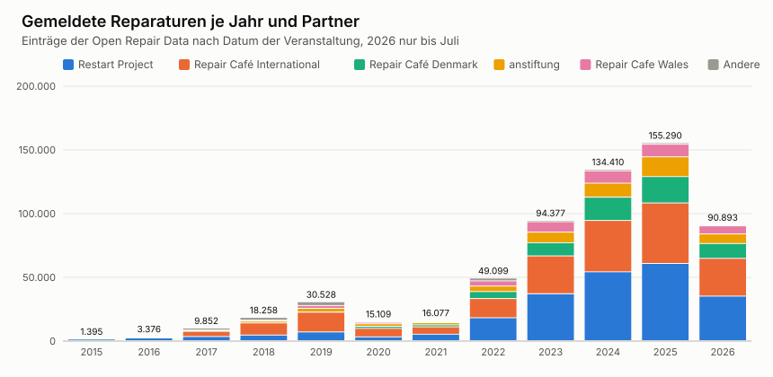
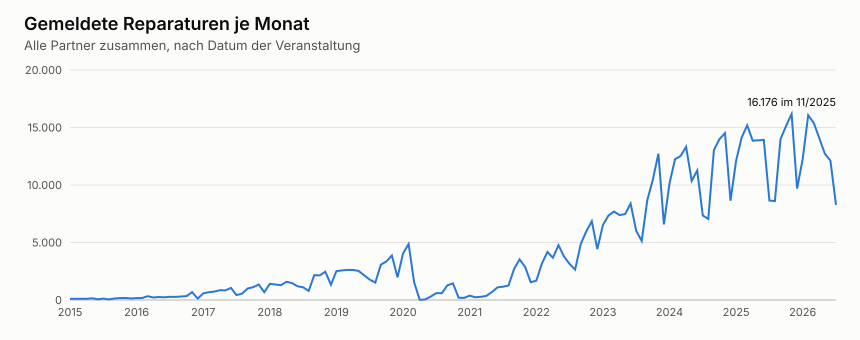
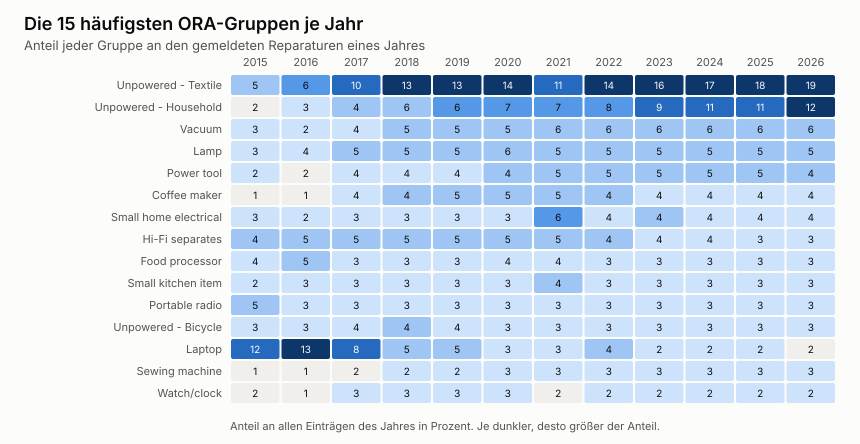

[[reparaturdaten]]
== Wie Reparaturen erfasst werden

_Teilfrage T1. Wie wird eine Reparatur erfasst und wie machen das andere Initiativen?_

.Auf einen Blick
====
*Worum es geht.* Wie das Repair Café und andere Initiativen Reparaturen erfassen, welche Felder der Open Repair Data Standard kennt und wo unsere Daten Lücken haben.

*Ergebnis.*

* In den Tickets von 2024 bis 2026 steht die Marke bei rund 25 Prozent, das Baujahr bei keinem.
* Den 941 bearbeiteten Geräten stehen 791 Tickets gegenüber. Ein vertagtes Gerät zählt in der Statistik an jedem Termin, hat aber nur ein Ticket.
* Bei der Open Repair Alliance kamen 30 von 1.485 Geräten an, rund 2 Prozent.

*Wichtigste Befehle.*

[source,bash]
----
python3 eval/ora/charts.py quellen/openrepair-data
python3 eval/ora/category_matrix.py quellen/openrepair-data
----
====

Reparaturdaten sind mehr als eine Statistik für den eigenen Verein. Zusammengeführt zeigen sie, welche Geräte kaputtgehen, woran Reparaturen scheitern und wo Hersteller nachbessern müssten. Damit das gelingt, müssen Daten aus vielen Initiativen und Werkzeugen vergleichbar werden. Dieses Kapitel beschreibt, wie eine Reparatur erfasst wird, im Repair Café Gütersloh und bei anderen Initiativen, wie die Open Repair Alliance die Daten vereinheitlicht und wie viel davon bei ihr ankommt. Von dort stammen auch die Gruppen, nach denen der Katalog in <<katalog>> geordnet ist.

[[erfassung-am-tisch]]
=== Erfassung am Reparaturtisch

[NOTE]
.Entwurf in Stichpunkten, Stand 2026-11-08
====
Dieser Abschnitt wird noch ausformuliert.
====

* Erfasst wird auf einem Laufzettel aus Papier, in einem Online-Formular oder in einer Tabelle, während oder nach dem Termin.
* Typische Felder sind Gegenstand, Marke, Alter, Fehler, Ergebnis und bei einem Fehlschlag der Grund.
* Lücken entstehen durch Zeitdruck am Tisch, wenig Platz auf dem Zettel und Abtippen im Nachhinein. Die Datenpotenzialanalyse hat das 2022 an 266 Laufzetteln gezeigt cite:[prange-2022].
* Szpak und Mather haben untersucht, wie Initiativen bei Veranstaltungen Daten aufnehmen cite:[szpak-mather].

[[erfassung-guetersloh]]
=== Erfassung im Repair Café Gütersloh

[NOTE]
.Entwurf in Stichpunkten, Stand 2026-11-08
====
Dieser Abschnitt wird noch ausformuliert.
====

Das Repair Café Gütersloh hat vier eigene Quellen.

* *Laufzettel von 2019 bis 2021.* 266 Laufzettel in sechs Varianten, von Hand digitalisiert und bereinigt in der Datenpotenzialanalyse. Daraus stammen die 279 Zeilen, an denen <<einordnung>> die erste echte Trefferquote misst.
* *Tickets in Zammad.* Seit November 2022 kommen Anfragen per Mail, Telefon oder Formular als Ticket an. Sie enthalten den Gegenstand oft nur im Betreff oder in der Nachricht und liegen wegen der persönlichen Daten nur lokal <<adr-0002>>.
* *Die eigene Statistik.* Das Team zählt je Termin angemeldete und bearbeitete Geräte, die Ergebnisse, die nicht erschienenen Gäste und die Spenden. Angemeldet ist dabei immer bearbeitet plus nicht erschienen. Spontane Gäste zählen also mit, getrennt erfasst werden sie erst ab jetzt nach <<adr-0033>>.
* *Laufzettel auf reparatur-initiativen.org.* Von dort gelangen die Einträge über die anstiftung in die Open Repair Data.

Wie vollständig die Tickets sind, zeigt eine Zählung der Exporte. Gezählt wurde nur, ob ein Feld gefüllt ist, nicht sein Inhalt.

.Gefüllte Felder in den Tickets der Gruppe Repair Café
[cols="3,1,1,1",options="header"]
|===
|Feld |2024 |2025 |2026
|Tickets |179 |300 |312
|Ergebnis |84 % |94 % |89 %
|Defekt |58 % |84 % |83 %
|Marke |23 % |25 % |27 %
|Bezeichnung |11 % |11 % |13 %
|Stromversorgung |9 % |6 % |4 %
|Baujahr |0 % |0 % |0 %
|Termin |3 % |70 % |99 %
|===

* Von 2024 bis 2026 stehen 941 bearbeitete Geräte 791 Tickets gegenüber. Spontane Gäste bekommen seit jeher einen Laufzettel oder ein Ticket, der Unterschied hat andere Gründe.
* Ein vertagtes Gerät zählt in der Statistik an jedem Termin, an dem es bearbeitet wird, hat aber nur ein Ticket. Zählt man je Ticket die Termine aus den Tags und lässt nicht erschienene Gäste weg, kommen 2025 auf 316 bearbeitete Geräte 307 Besuche und 2026 auf 337 Geräte 302 Besuche.
* 2024 tragen die Tickets noch keine Termine. Dort stehen 150 Tickets mit Ergebnis 288 bearbeiteten Geräten gegenüber. Woher diese Lücke kommt, ist offen.
* Das Ergebnis trägt oft einen Grund, etwa „nicht erfolgt::Ersatzteil zu teuer“. Sechs dieser Gründe entsprechen genau den sechs Hindernissen des Standards.
* Marke, Bezeichnung, Stromversorgung und Baujahr fehlen meist. Daraus folgen die Verbesserungen in <<adr-0034>>.

[[ora]]
=== Open Repair Alliance und der Standard

Die Open Repair Alliance wurde von der anstiftung, Fixit Clinic, iFixit, der Repair Café Foundation und The Restart Project gegründet. The Restart Project koordiniert sie seit November 2017 cite:[ora-standard]. Die Alliance führt die Daten ihrer Partner zweimal im Jahr zu einem gemeinsamen Datensatz zusammen und veröffentlicht ihn unter CC BY-SA 4.0 cite:[ora-datasets]. Ausgewertet ist hier die Version 0.3 vom Juli 2026 cite:[ora-data].

[[ords]]
Der Standard legt fest, welche Felder ein Eintrag hat und welche Werte erlaubt sind cite:[ora-standard].

[cols="2,3,4",options="header"]
|===
|Feld |Name |Inhalt
|ID |`id` |Kennung beim Partner
|Kategorie des Partners |`partner_product_category` |eigene Liste oder Freitext
|Produktkategorie |`product_category` |eine von 40 Gruppen mit Strom, dazu Gruppen ohne Strom
|Marke |`brand` |Freitext
|Baujahr und Alter |`year_of_manufacture`, `product_age` |Jahr bzw. Alter in Jahren
|Problem |`problem` |Freitext ohne persönliche Daten
|Ergebnis |`repair_status` |Fixed, Repairable, End of life oder Unknown
|Hindernis |`repair_barrier_if_end_of_life` |sechs Gründe, nur bei End of life
|Gruppe und Datum |`group_identifier`, `event_date` |wer wann repariert hat
|===

Entscheidend für diese Arbeit ist das Verhältnis der ersten beiden Kategoriefelder. Jeder Partner erfasst mit seiner eigenen Liste. Die Alliance ordnet jede dieser Kategorien einer Produktkategorie des Standards zu und prüft die Zuordnung bei jedem neuen Datensatz cite:[ora-datasets]. Die Produktkategorien des Standards heißen in dieser Arbeit ORA-Gruppen.

[[partner]]
=== Andere Initiativen und ihre Werkzeuge

Der Datensatz enthält 620.000 Einträge von neun Partnern.

.Partner der Open Repair Alliance im Datensatz vom Juli 2026
[format=tsv,cols="3,2,2,2,1,1,1,1,1,1,1",options="header"]
|===
Partner	Einträge	Länder	Jahre	feste Stufe	Werte Stufe 1	Werte gesamt	Marke gefüllt	Baujahr gefüllt	Problem gefüllt	Hindernis gefüllt
include::../../docs/ora/partner.tsv[lines=2..-1]
|===

Die Spalte „feste Stufe“ zeigt, welcher Teil der Kategorie eines Partners aus einer festen Liste stammt. Eine 1 heißt, die erste Stufe ist fest und die zweite Freitext. Eine 2 heißt, beide Stufen sind fest. Eine 0 heißt, es gibt nur Freitext.

[[werkzeuge]]
Die Alliance empfiehlt, Reparaturen mit dem Werkzeug eines Partners zu erfassen, und bittet, nur ein Werkzeug zu nutzen, weil sonst doppelt gezählt wird cite:[ora-record].

.Werkzeuge der Partner zum Erfassen von Reparaturen
[cols="2,2,3,2",options="header"]
|===
|Werkzeug |Partner |Kategorien |Schnittstelle
|Restarters.net mit Fixometer |The Restart Project, auch iFixit |47 feste Kategorien, dazu der Gegenstand als Freitext |API mit Lesen und Schreiben
|Repair Monitor |Repair Café International |16 Hauptkategorien mit festen Unterkategorien |keine öffentliche gefunden
|Laufzettel auf reparatur-initiativen.org |anstiftung |13 Ober- und rund 1.190 Unterkategorien, Initiativen können neue vorschlagen |API nur zum Lesen von Statistiken
|Online-Formulare |Repair Cafe Wales, Fixit Clinic |grobe Liste bzw. Freitext |keine
|Tabellen |Repair Café Denmark, Repair Café Toronto |Freitext |keine
|Repair Connects |Repair Together |direkt die ORA-Gruppen |keine gefunden
|===

Nur Restarters.net erlaubt es, Reparaturen über eine Schnittstelle anzulegen. Die API der anstiftung liefert Initiativen und Statistiken und braucht ein Token, ein Endpunkt für Laufzettel fehlt.

[[vereinheitlichung]]
=== Vereinheitlichung der Kategorien

Die Werkzeuge der Partner zeigen drei Wege, Kategorien vergleichbar zu machen.

. *Eine gemeinsame Liste beim Erfassen.* Repair Connects erfasst direkt mit den ORA-Gruppen. Eine Zuordnung ist dann nicht mehr nötig, die Gruppen sind aber für die Arbeit am Tisch grob.
. *Eine eigene feste Liste mit Zuordnung im Nachhinein.* So arbeiten anstiftung, Repair Café International und Restarters. Die Alliance ordnet jede Kategorie einmal einer ORA-Gruppe zu und kann das für alle Einträge wiederverwenden.
. *Freitext mit Zuordnung im Nachhinein.* Denmark, Toronto und Fixit Clinic melden nur Freitext. Jeder neue Wert muss einzeln zugeordnet werden.

[[kategorien-vergleich]]
Die Matrix in <<anhang-kategorien>> stellt für jede ORA-Gruppe nebeneinander, mit welchen eigenen Kategorien die Partner deren Einträge erfasst haben. Die vollständige Zuordnung jeder Kategorie zu ihren ORA-Gruppen liegt in {repo}/docs/ora/kategorien-zuordnung.tsv[kategorien-zuordnung.tsv]. Drei Beobachtungen sind für MANUEL wichtig.

* *Feine Listen lassen sich eindeutig zuordnen.* Fast jede Kategorie der anstiftung landet bei genau einer ORA-Gruppe, nur 14 Zeilen der Zuordnung sind mehrdeutig. Unser Katalog baut auf dieser Liste auf und übernimmt damit diese Eindeutigkeit.
* *Grobe Listen brauchen den Freitext.* Restarters erfasst etwa Ladegeräte zu 70 Prozent unter Misc. Erst der Freitext im Feld für den Gegenstand erlaubt der Alliance die Zuordnung zu Battery/charger/adapter. Beim Repair Monitor verteilt sich fast jede dritte Unterkategorie auf mehrere Gruppen.
* *Freitext allein ist schwer auszuwerten.* Bei Toronto und Fixit Clinic decken selbst die 60 häufigsten Werte nur 57 bzw. 29 Prozent der Einträge ab, Schreibfehler und Mehrzahl inklusive.

MANUEL verbindet den zweiten Weg mit dem ersten. Der Katalog nutzt die feine Liste der anstiftung und trägt die ORA-Gruppe schon im Schlüssel <<adr-0013>>. Die Zuordnung geschieht damit einmal im Katalog statt bei jeder Meldung. Der Wortlaut der Anfrage bleibt im Ticket erhalten, so wie es die Datenpotenzialanalyse für jeden Rohwert empfohlen hat cite:[prange-2022].

[[datensatz]]
=== Der Datensatz im Überblick

Die Zahl der gemeldeten Reparaturen ist stark gewachsen, von 1.395 im Jahr 2015 auf 155.290 im Jahr 2025. Der Sprung ab 2022 kommt von allen großen Partnern gleichzeitig. 2020 bricht die Kurve wegen der Pandemie fast auf null ein. Jeden Sommer und um den Jahreswechsel gibt es Täler, weil dann weniger Veranstaltungen stattfinden. The Restart Project und Repair Café International liefern zusammen 70 Prozent aller Einträge.

.Gemeldete Reparaturen je Jahr und Partner

.Gemeldete Reparaturen je Monat

Auch die Mischung der Geräte hat sich verschoben. Textilien und Gegenstände ohne Strom aus dem Haushalt machen 2026 zusammen fast ein Drittel aus, 2015 waren es 7 Prozent. Laptops fielen von 12 auf 2 Prozent. Das liegt vermutlich weniger an den Geräten als an den Partnern. Anfangs meldete fast nur The Restart Project, dessen Veranstaltungen sich auf Elektronik konzentrieren.

.Die 15 häufigsten ORA-Gruppen je Jahr

Hinter den Einträgen stehen Gruppen und ihre Termine. Bei der anstiftung melden 169 Initiativen an 4.478 Terminen im Median 10 Geräte je Termin. Toronto und Fixit Clinic melden jeweils als eine einzige Gruppe.

.Gruppen, Termine und Einträge je Partner
[format=tsv,cols="3,1,1,1,1,1,1",options="header"]
|===
Partner	Gruppen	Termine	Einträge	je Termin im Median	je Termin im Mittel	je Termin höchstens
include::../../docs/ora/events_by_partner.tsv[lines=2..-1]
|===

[[eigene-daten]]
=== Wie viel bei der Alliance ankommt

Der Datensatz der Alliance zeigt nur, was gemeldet wird. Beim Repair Café Gütersloh ist das ein kleiner Teil. Die eigene Statistik zählt seit 2019 1.485 bearbeitete Geräte an 85 Terminen. Auf reparatur-initiativen.org stehen für dieselbe Zeit 30 Laufzettel, das sind rund 2 Prozent. Alle 30 finden sich in den Open Repair Data wieder, unter der Gruppe 17503 mit denselben Terminen und Kategorien. Der Weg über die anstiftung funktioniert also. Es wird nur fast nichts gemeldet, weil jeder Laufzettel von Hand abgetippt werden muss.

.Bearbeitete Geräte und gemeldete Laufzettel des Repair Café Gütersloh
[cols="1,1,1,1",options="header"]
|===
|Jahr |Termine |bearbeitet |Laufzettel
|2019 |11 |147 |0
|2020 |6 |86 |22
|2021 |4 |45 |7
|2022 |2 |39 |0
|2023 |14 |227 |0
|2024 |14 |288 |0
|2025 |16 |316 |1
|2026 |18 |337 |0
|Summe |85 |1.485 |30
|===

Bei anderen Initiativen dürfte es ähnlich sein. Für die Auswertungen der Alliance heißt das, dass die Zahlen die Vielfalt der Geräte zeigen, aber nicht den Umfang der Reparaturen. Für MANUEL ist es der wichtigste Grund, die Übertragung zu automatisieren. <<weitergabe>> zeigt, wie sich die Lücke für die Jahre ab 2024 schließen lässt.

// Ergebnis folgt in Stufe 3, Antwort auf T1.

.Zum Nachvollziehen
****
* Auswertung der Open Repair Data mit {repo}/eval/ora/category_matrix.py[category_matrix.py] und {repo}/eval/ora/charts.py[charts.py], Tabellen in {repo}/docs/ora[docs/ora]
* Quellen im Repo unter {repo}/quellen[quellen], siehe <<adr-0028>>
* Zählung der Felder aus den lokalen Exporten von Zammad, nur Summen
* Entscheidungen <<adr-0007>>, <<adr-0013>>, <<adr-0014>>, <<adr-0034>>
****

[NOTE]
.Quellen und offene Punkte für dieses Kapitel
====
* cite:[ora-standard], cite:[ora-datasets], cite:[ora-record], cite:[ora-members], cite:[ora-data], cite:[szpak-mather], cite:[prange-2022]
* Noch zu suchen sind die Reparatur-Statistik der anstiftung, Beschreibungen von Fixometer und Repair Monitor und Studien zur Erfassung bei Repair Cafés.
* Offen ist, ob die Tabelle der Felder auch die Laufzettel von 2019 bis 2021 zum Vergleich zeigen soll.
====
