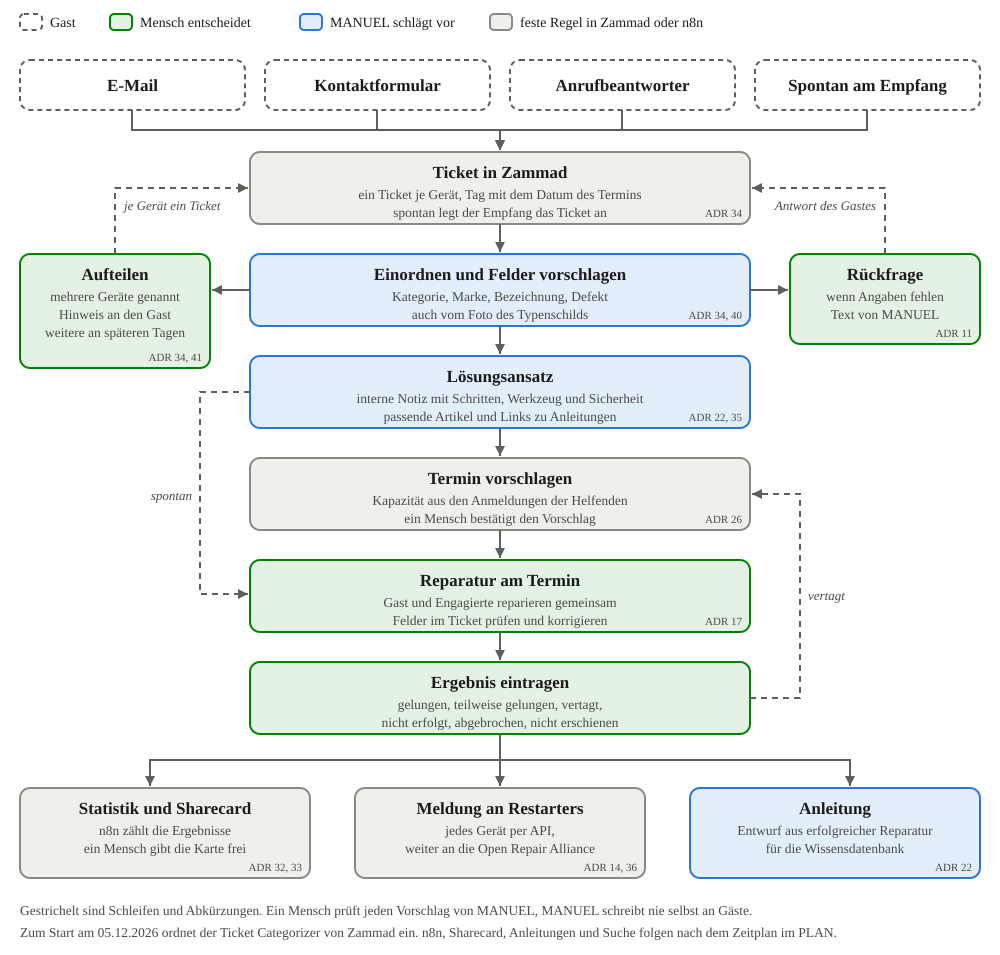

[[aufgaben]]
== Was MANUEL übernehmen soll

_Teilfrage T2. Welche Aufgaben kann ein lokales Modell übernehmen, welche bleiben bei Menschen oder festen Regeln?_

.Auf einen Blick
====
*Worum es geht.* Welche Aufgaben MANUEL übernimmt und welche bei Menschen oder festen Regeln bleiben. Das Ablaufdiagramm zeigt den Weg einer Anfrage vom Eingang bis zur Meldung.

*Ergebnis.*

* MANUEL bereitet vor, ein Mensch entscheidet.
* Code rechnet, das Modell formuliert. Zählen, Zuordnen, Termine planen und Daten übertragen laufen nach festen Regeln.
* Die Prüfung der Daten in Kapitel 2 bringt vier neue Aufgaben zur Erfassung.
* Zum Start ordnet der Ticket Categorizer von Zammad ein, ohne Angabe der Sicherheit <<adr-0040>>.

*Wichtigste Befehle.* Keine.
====

[NOTE]
.Entwurf in Stichpunkten, Stand 2026-11-08
====
Dieses Kapitel steht noch in Stichpunkten.
====

=== Aufgaben im Repair Café

* Tabelle der Aufgaben aus dem {repo}/PLAN.md[PLAN] mit der Spalte, wer sie erledigt, also Sprachmodell, Decision-Modell, Zammad oder n8n
* Felder füllen, also Art des Geräts, Defekt, Stromversorgung, Marke, Bezeichnung und Baujahr
* Reparaturansatz als interne Notiz, Lösung aus Stichworten formulieren, Anleitungen in der Wissensdatenbank
* Tickets zusammenfassen und verknüpfen, Gästedaten als Vorschlag
* Terminvorschläge, Statistik, Meldung an die Open Repair Alliance, Newsletter mit Einwilligung

=== Neue Aufgaben zur Erfassung

* Ein Ticket je Gerät, auch für spontane Gäste <<adr-0034>>
* Foto vom Typenschild, das Hauptmodell liest Marke, Bezeichnung und Datumscode <<adr-0034>>
* Felder aus dem Katalog, etwa die Stromversorgung aus der Kategorie <<adr-0034>>
* Websuche nach Anleitungen nur mit Marke und Modell <<adr-0035>>

=== Was Zammad selbst kann

* Zammad bringt eigene KI-Agenten mit, nämlich Ticket Categorizer, Text Extractor, Title Rewriter, Tagger, Prioritizer, Group Dispatcher und Custom AI Agent. Sie laufen nur, wenn ein Trigger, ein geplanter Job oder ein Makro sie auslöst.
* Jede Änderung durch einen Agenten steht mit seinem Namen im Verlauf des Tickets.
* Ist ein Modell mit Bildverständnis eingerichtet, liest Zammad Bilder in Nachrichten per Texterkennung und gibt den Text an die Agenten weiter. Das passt zum Foto vom Typenschild <<adr-0034>>.
* Der Categorizer gibt nur einen Wert zurück und keine Sicherheit. Zum Start am 05.12.2026 nutzen wir ihn trotzdem und steigen bei Bedarf um <<adr-0040>>.
* Ob unsere Version von Zammad all das schon kann, ist noch zu prüfen.

=== Grundsätze

* Ein Mensch entscheidet <<adr-0017>>. MANUEL antwortet nie selbst an Gäste.
* Daten bleiben lokal <<adr-0002>>. Einzige Ausnahme sind Marke und Modell für die Websuche <<adr-0035>>.
* Code rechnet und das Modell formuliert.
* Alles ist Code, also Image, Prompts, Workflows und Auswertungen im Repo.

[[landkarte]]
=== Der Weg einer Anfrage

.Der Weg einer Anfrage im Repair Café

* Die Stationen und ihre Kapitel
** Anfrage geht ein, Kapitel 4 zeigt, wo sie verarbeitet wird
** Einordnen, Kapitel 5 und 6
** Erstdiagnose und Reparaturansatz, Kapitel 7
** Termin, Kapitel 8
** am Tisch reparieren, Ergebnis eintragen
** zählen, teilen und melden, Kapitel 9

=== Datenschutz in Kürze

* Löschfristen, Verzeichnis von Verarbeitungstätigkeiten, Testdaten nur lokal, Verschlüsselung vor dem Umzug in den Makerspace
* Ausführlich in <<recht>>

// Ergebnis folgt in Stufe 3, Antwort auf T2.

.Zum Nachvollziehen
****
* {repo}/PLAN.md[PLAN] mit Aufgaben, Grundsätzen und Phasen
* Entscheidungen <<adr-0002>>, <<adr-0017>>, <<adr-0018>>, <<adr-0034>>, <<adr-0035>>, <<adr-0040>>
* Quellcode von Zammad als Submodul `quellen/zammad`, die Agenten unter https://github.com/zammad/zammad/tree/3b0c2ed25738922dd1651c81cd9bee815b4cd6e8/app/models/ai/agent/type[app/models/ai/agent/type]
****

[NOTE]
.Quellen und offene Punkte für dieses Kapitel
====
* Die KI-Agenten von Zammad sind im Quellcode geprüft. Noch zu suchen sind die Doku zu Core Workflows und Wissensdatenbank sowie Literatur zu Systemen, bei denen ein Mensch entscheidet.
* Offen ist, welche Aufgaben bis zum Ende der Erprobung wirklich laufen.
====
