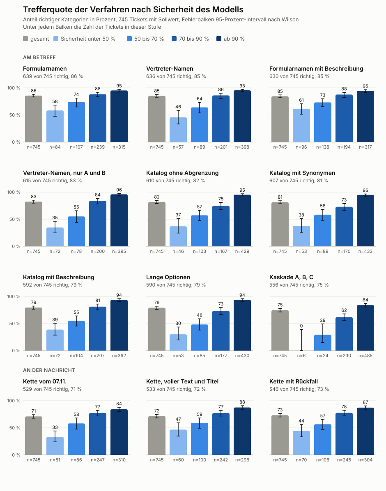

[[einordnung]]
== Anfragen einordnen

_Teilfrage T4. Wie zuverlässig ordnet MANUEL Anfragen ein und wann muss ein Mensch entscheiden?_

.Auf einen Blick
====
*Worum es geht.* Wie MANUEL aus einer Anfrage die Kategorie bestimmt, erzählt an fünf Wendepunkten vom ersten Versuch bis zur Rückfrage bei Unsicherheit.

*Ergebnis.*

* Am Ende sind 98,7 Prozent der 745 Tickets richtig eingeordnet oder führen zu einer Rückfrage, nur 10 sind sicher falsch.
* Die meisten Fehler lagen nicht am Modell, sondern an der Liste der Kategorien.
* Eine Rückfrage ist besser als ein Fehler, deshalb fragt MANUEL bei Sammelbegriffen und Unsicherheit nach.
* Zum Start am 05.12.2026 sollte der Ticket Categorizer von Zammad ohne Sicherheit einordnen. Im Vorabtest wären mit der besten Liste 17,5 Prozent der Einträge falsch, die Grenze für den Umstieg liegt bei 5 Prozent <<adr-0040>>.

*Wichtigste Befehle.*

[source,bash]
----
cd eval/decision
python3 real_representatives.py tickets.json eintraege.json ergebnis.jsonl d3:9b alle 0.7
python3 evaluate.py
----
====

[NOTE]
.Entwurf in Stichpunkten, Stand 2026-11-13
====
Dieses Kapitel steht noch in Stichpunkten. Es erzählt fünf Wendepunkte, alle 16 Schritte stehen in {repo}/docs/einordnung.md[docs/einordnung.md].
====

.Beispiel k04, die Kaffeemaschine
****
* Einordnung des Betreffs und der Nachricht mit Sicherheit des Modells, aus einem Lauf mit `lauf.json`
****

=== Daten und Sollwerte

* 746 echte Tickets von 2024 bis 2026, davon 745 mit Sollwert aus der Kontrolle durch das Team und einer zweiten Prüfung
* 279 Laufzettel von 2019 bis 2021 aus der Datenpotenzialanalyse als öffentlicher Vergleich
* Eine Rückfrage zählt als ohne Fehler, sichere Fehler werden getrennt gezählt.
* Jede Trefferquote bekommt ein Intervall nach Wilson cite:[wiki-wilson], das auch bei kleinen Zahlen brauchbar ist.
* Echte Tickets liegen nur lokal, in die Arbeit kommen nur Summen <<adr-0002>>.

=== Wendepunkt 1, Gefahren zuerst

* 83 erfundene Tickets zeigen, dass `d3:9b` sicherheitsrelevante Fälle fast perfekt trennt.
* Die Markierung ist ein Hinweis für die Engagierten und keine Kategorie. Das Repair Café schaut sich alles an, was Gäste bringen, und weist niemanden wegen einer Gefahr ab. Wie Gefahren eingeordnet werden, überarbeiten wir noch.
* Die Formulierung der Optionen entscheidet über das Ergebnis.
* Eine Übersetzung ins Englische hilft kleinen Modellen, bringt aber neue Fehler. Aus „funkt innen“ wurde „leaking radiation“.

=== Wendepunkt 2, eine Stufe mit Vorauswahl

* Zwei Stufen mit 386 Kategorien scheitern, weil eine falsche erste Stufe die richtige Antwort verdeckt.
* Eine Ähnlichkeitssuche wählt 25 Kandidaten, das Decision-Modell entscheidet in einer Stufe <<adr-0004>>.
* Das Sprachmodell taugt nicht als zweite Instanz <<adr-0005>>.
* An den 279 Laufzetteln zeigt sich, dass die Sicherheit des Modells aussagekräftig ist. Wie gut Sicherheit und Trefferquote zusammenpassen, heißt Kalibrierung cite:[guo-2017].

=== Wendepunkt 3, erst herausziehen, dann einordnen

* Lange Nachrichten überfordern das Decision-Modell, Betreffe gehen deutlich besser.
* Das Sprachmodell zieht die Gegenstände heraus, das Decision-Modell ordnet sie ein <<adr-0006>>. So werden auch mehrere Geräte in einer Anfrage erkannt.
* Mit vollständigem Text, dem Titel der Notizen und einem Rückfall auf den Betreff steigt die Zahl der Treffer von 529 auf 546.
* Noch zu prüfen ist, wie zuverlässig MANUEL erkennt, dass mehrere Gegenstände angemeldet sind. Bisher sind es 17 von 21 aufgeteilten Anfragen.
* Noch zu prüfen ist, wie zuverlässig MANUEL erkennt, dass gar kein Gegenstand angegeben ist, und ob dann eine Nachfrage beim Gast folgt.

=== Wendepunkt 4, die Liste ist das Problem

* Nach der Kontrolle durch das Team sind am Betreff 83 Prozent richtig. Die meisten Fehler liegen an der Liste.
* Mehr Einträge helfen nicht, fast gleiche Namen verwirren das Modell.
* Gleichwertige Kategorien werden zusammengefasst <<adr-0008>>, und jeder Eintrag erscheint einmal unter seinem passendsten Namen <<adr-0010>>.
* Die ORA-Gruppe zuerst zu wählen bringt für die Kategorie keinen Gewinn.

=== Wendepunkt 5, Rückfrage statt Fehler

* Viele sichere Fehler entstehen bei Sammelbegriffen wie Kopfhörer und bei Bauteilen oder Dienstleistungen wie Netzteil oder Linux installieren.
* Für beide Fälle löst eine Regel eine Rückfrage aus, und die Nachricht klärt einen Teil davon gleich selbst <<adr-0011>>. In der Forschung heißt das selektive Klassifikation, ein Modell darf sich enthalten, um weniger Fehler zu machen cite:[geifman-2017].
* Von den verbleibenden 10 Fehlern steht bei fünf das Gerät nur in der Nachricht, vier sind Grenzfälle und einer ist eine echte Verwechslung.
* Ergebnis sind 657 von 745 richtig, 10 sichere Fehler und 179 Rückfragen, also 98,7 Prozent ohne Fehler.

.Trefferquote der Verfahren nach Sicherheit des Modells

=== Weg in den Betrieb

* Der gemessene Weg braucht die Sicherheit von `d3:9b`. Der Ticket Categorizer von Zammad liefert sie nicht <<adr-0040>>.
* Zum Start am 05.12.2026 ordnet trotzdem der Categorizer mit dem Sprachmodell ein, mit einer kürzeren Liste und einem festen Namen je Eintrag. Vertreter-Namen gibt es erst mit dem Weg über n8n. Alle 1.089 Einträge sind zu viele.
* Ein Vorabtest an den geprüften Tickets zeigt vorher, wie viele falsche Einträge zu erwarten sind und welche Liste am besten passt.
* Ab 5 Prozent falscher Einträge oder auf Wunsch des Teams folgt der Umstieg auf n8n mit Sicherheit und Rückfrage.
* Der Vorabtest vom 13.11.2026 stellt den Prompt des Categorizer aus dem Quellcode von Zammad nach und lässt ihn an 739 Tickets laufen. Als falsch zählt jede eingetragene Art, die nicht dem Sollwert entspricht.
+
[cols="4,2,2,2,2,3",options="header"]
|===
|Liste |Optionen |richtig |leer |falsch |falsch von allen Einträgen
|A-Einträge |114 |454 |163 |122 |21,2 %
|A- und B-Einträge |365 |539 |86 |114 |17,5 %
|ORA-Gruppen |46 |539 |14 |186 |25,7 %
|===
* Ein Teil der Fehler ist harmlos für die Meldung an die ORA. Bei A und B landen 64 Einträge in der richtigen Gruppe, oft als Sammelbegriff wie Kaffeemaschine statt Vollautomat. Ohne sie bleiben 7,7 Prozent, also immer noch über der Grenze.
* Ohne Rückfrage fehlt der Weg, unsichere Fälle abzufangen. Der gemessene Weg mit `d3:9b` liegt bei 1,8 Prozent falscher Einträge.
* Damit ist der Umstieg nach <<adr-0040>> fällig. Wann und wie, entscheidet das Team. Alle Zahlen stehen in Schritt 17 von {repo}/docs/einordnung.md[docs/einordnung.md].

=== Wirkung der Aufbereitung

* Vergleich roh gegen aufbereitet wie Tabelle 2 der Datenpotenzialanalyse, aus dem Abschnitt „Wirkung der Aufbereitung“ in {repo}/docs/einordnung.md[docs/einordnung.md]

// Ergebnis folgt in Stufe 3, Antwort auf T4.

.Zum Nachvollziehen
****
* Alle Schritte mit Zahlen in {repo}/docs/einordnung.md[docs/einordnung.md]
* Skripte in {repo}/eval/decision[eval/decision], darunter {repo}/eval/decision/follow_up.py[follow_up.py] für die Regeln
* Vorabtest des Ticket Categorizer mit {repo}/eval/categorizer/vorabtest.py[vorabtest.py], die Ergebnisse liegen nur lokal
* Grafik aus {repo}/eval/decision/chart_classification.py[chart_classification.py]
* Ein Lauf mit Vertreter-Namen, im Ordner `eval/decision`. Die Tickets liegen nur lokal.
+
[source,bash]
----
python3 real_representatives.py tickets.json eintraege.json ergebnis.jsonl d3:9b alle 0.7
python3 evaluate.py
----
* Entscheidungen <<adr-0003>> bis <<adr-0011>>
****

[NOTE]
.Quellen und offene Punkte für dieses Kapitel
====
* cite:[wiki-wilson], cite:[guo-2017], cite:[geifman-2017]
* Noch zu suchen ist Literatur zur Einordnung mit Sprachmodellen ohne eigenes Training.
* Offen ist die Bestätigung an neuen Tickets, denn Sollwerte und Regeln stammen aus denselben Daten.
* Offen ist die Überarbeitung der Gefahren, siehe Wendepunkt 1.
* Je Wendepunkt soll eine Grafik zeigen, was versucht wurde und was es brachte.
====
