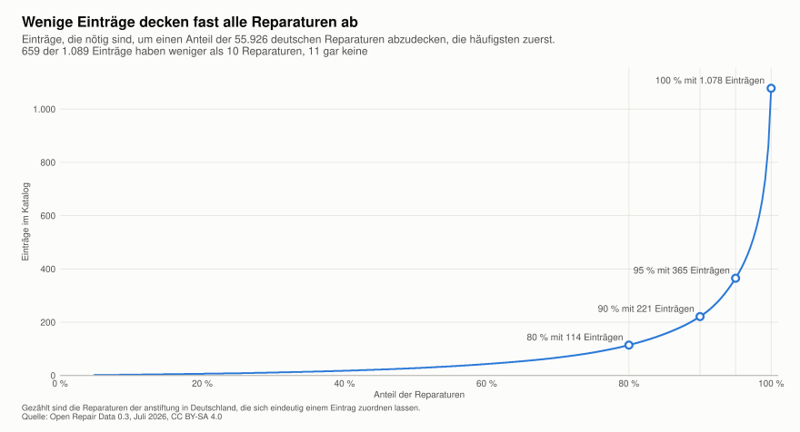

[[katalog]]
== Der Katalog der Gegenstände

_Teilfrage T4. Wie zuverlässig ordnet MANUEL Anfragen ein und wann muss ein Mensch entscheiden? Dieses Kapitel zeigt die Liste, auf der die Einordnung beruht._

.Auf einen Blick
====
*Worum es geht.* Die Liste der Gegenstände, auf der die Einordnung beruht, und wie sie aus den Listen der anstiftung und der Open Repair Alliance entstand.

*Ergebnis.*

* Der Katalog vereint die feine Liste der anstiftung mit den Gruppen der Open Repair Alliance.
* Jeder Eintrag hat einen Schlüssel, der seine ORA-Gruppe schon enthält.
* Der Katalog steht offen unter CC BY-SA 4.0 und lässt sich von anderen Initiativen nachnutzen.
* Der Katalog hat 1.089 Einträge. Englische Namen fehlen noch bei 863 davon.
* 221 Einträge decken 90 Prozent der deutschen Reparaturen ab, für das letzte Prozent braucht es 373 Einträge.
* Felder und Werte von ORA, anstiftung und Restarters liegen als Tabellen vor und lassen sich mit jeder neuen Quelle neu erzeugen.

*Wichtigste Befehle.*

[source,bash]
----
python3 katalog/check.py
python3 katalog/entries.py quellen/anstiftung/kategorien.csv eintraege.json
toolbox run -c manuel-r Rscript eval/categorizer/coverage.R
python3 eval/fields/import_sources.py
toolbox run -c manuel-r Rscript eval/fields/import_partners.R
----
====

[NOTE]
.Entwurf in Stichpunkten, Stand 2026-11-14
====
Dieses Kapitel steht noch in Stichpunkten.
====

.Beispiel k01, der Wasserkocher
****
* Der Eintrag Wasserkocher hat den Schlüssel 14.401. Die 14 steht für die ORA-Gruppe Kettle, die 401 für die Kategorie im Laufzettel der anstiftung.
* Englischer Name „Electric kettle“, Stromversorgung 230 V, Synonym „Wasserkessel, elektrisch“
****

=== Aufbau und Quellen

* 1.089 Einträge mit Namen, Beschreibung und Synonymen auf Deutsch und Englisch, ORA-Gruppe, Stromversorgung und den Kategorien der anstiftung
* Quellen sind das Formular der anstiftung mit 1.208 Kategorien und die Open Repair Data <<adr-0007>>, <<adr-0028>>
* Lizenz CC BY-SA 4.0 <<adr-0009>>

=== Schlüssel

* Form `ORA.Restarters.anstiftung.eigene`, etwa 14.39.401 für den Wasserkocher. Jeder Gegenstand gehört damit eindeutig zu einer Gruppe der ORA, einer Kategorie bei Restarters und den Kategorien der anstiftung.
* Eigene Aufteilungen bekommen eine vierte Stelle, etwa 11.24.459.1 und 11.24.459.2 für zwei Arten von Kopfhörern <<adr-0013>>
* Bei Laptop und Flat screen steht für Restarters eine 0, dort entscheidet die Größe des Geräts.
* Mit dem Start in Zammad werden die Schlüssel eingefroren.

=== Sprache

* Deutsche und englische Namen, der englische Name wird bei Restarters zum Gegenstand.
* Synonyme ordnen Begriffe der richtigen Kategorie zu.
* Keine abwertenden Begriffe, ein solcher wurde durch Radiorekorder ersetzt <<adr-0012>>.

[[abdeckung]]
=== Wie viele Einträge gebraucht werden

* 1.078 der 1.089 Einträge kommen in den deutschen Reparaturen der Open Repair Data mindestens einmal vor. Gezählt sind die 55.926 Reparaturen der anstiftung, die sich eindeutig einem Eintrag zuordnen lassen.
* Die übrigen 11 sind unsere eigene Aufteilung der Kopfhörer und neun Kategorien, die erst nach dem Stand der Daten vom Juli 2026 in den Laufzettel kamen, etwa Campinglampe und Saunaofen.
* Die meisten Einträge sind selten. 659 haben weniger als 10 Reparaturen, 217 genau eine, etwa Braukessel und Marderschreck.
* 1 Prozent der Reparaturen sind rund 560 Geräte. Bis 95 Prozent kostet jedes weitere Prozent unter 40 Einträge, das letzte Prozent braucht 373.
* Daraus folgt die Reihenfolge der Arbeit am Katalog. Zuerst werden die rund 220 häufigsten Einträge bestätigt, die übrigen bleiben Entwurf, bis einer davon in einem Ticket auftaucht.

.Kategorien im Katalog nach dem Anteil der Reparaturen, den sie abdecken

[[felder-plattformen]]
=== Felder und Werte der Plattformen

* Damit ein Eintrag zu allen drei Plattformen passt, brauchen wir deren Felder und Werte nebeneinander. Je Plattform gibt es eine Tabelle, die Kopfzeile nennt die Felder so, wie die Plattform sie nennt, darunter stehen alle möglichen Werte.
* Die Tabellen entstehen in den Schritten Import, Tidy und Transform nach cite:[wickham]. So lässt sich eine Quelle einfach aktualisieren, und jeder Schritt bleibt nachvollziehbar.
** *Import.* Jede Quelle wird möglichst unverändert eine Tabelle. Python liest die Quellen, die noch keine Tabellen sind, also den Standard, `database.sql` der anstiftung und die PHP-Dateien von Restarters. R liest die aggregierten Open Repair Data und schreibt je Partner die Kategorien mit ihrer ORA-Gruppe und die Schreibweisen der Marken.
** *Tidy.* Alle Tabellen kommen in dieselbe Form, eine Zeile je Feld, je Wert und je Zuordnung zur ORA. Steht noch aus.
** *Transform.* Daraus entstehen die Ansichten, also die Tabellen je Plattform, ein Vergleich der Ergebnisse und die Zuordnung der Kategorien. Steht noch aus.
* Der Quellcode von Restarters ist dafür als Submodul eingebunden. Er enthält Übersetzungen in neun Sprachen. Alle 47 Kategorien und alle festen Werte haben eine deutsche Fassung, etwa Kaffeemaschine für Coffee maker und Mehr Zeit benötigt für More time needed.
* Beim Anlegen eines Geräts fragt Restarters zuerst, ob es elektrisch ist, und zeigt danach nur die passenden Kategorien. Misc gibt es deshalb zweimal.
* Restarters exportiert seine Daten selbst im Format der ORA, die Zuordnung steht in https://github.com/TheRestartProject/restarters.net/blob/d46501cb20a0bda1216ffb2e48a19f074e86f776/config/ords.php[config/ords.php]. Die fünf Bildschirmgrößen werden zu Flat screen und die drei Laptopgrößen zu Laptop. Hand tool und Misc ohne Strom werden beide zu Unpowered - Other. Die offenen Fälle im Katalog zwischen diesen beiden betreffen also nur Restarters.
* Auch die anstiftung ordnet ihre Kategorien in `database.sql` einer ORA-Gruppe zu, aber nur 114 der 1.208 Kategorien des Laufzettels. Der Dump ist älter als der Laufzettel und kennt etwa Fehler nicht gefunden noch nicht.
* Vollständiger ist, wie die Alliance die Daten der anstiftung selbst zugeordnet hat. Das sind 1.179 Kategorien, jede zu mindestens 90 Prozent in derselben Gruppe. Bei 28 Kategorien weicht die Alliance von der anstiftung ab und wählt oft die groben Gruppen Small home electrical und Large home electrical, etwa für Schrittzähler und Taschenrechner.
* Für den Katalog ist diese Zuordnung der Alliance ein Vorschlag und eine Prüfung der eigenen ORA-Gruppe.

[[marken]]
=== Marken

* Bei der anstiftung ist die Marke eine feste Liste mit 3.371 Einträgen, bei Restarters und in den Open Repair Data Freitext.
* Die Schreibweisen gehen weit auseinander. In den Daten von Restarters steht Phillips 3.598-mal.
* ords-extra enthält eine Tabelle mit 3.530 falschen Schreibweisen und der richtigen Marke cite:[repo-ords-extra]. Wir wenden sie auf unsere eigenen Daten an, die Originalmarke bleibt daneben erhalten <<adr-0052>>.
* Die Tabelle ordnet nach ähnlichen Buchstaben zu und macht dabei aus eigenen Marken andere, etwa aus Teufel Tefal, aus Canton Canon und aus Olympia Olympus. Solche Fehlgriffe kommen in eine eigene Liste der Ausnahmen. Schreibweisen, die zu mehr als einer Marke führen wie TechniSat, bleiben unangetastet.
* Die englischen Namen der Gegenstände aus ords-extra dienen genauso als Vorschlag für die fehlenden englischen Namen im Katalog.

=== Beschreibungen für Rückfragen

* Beschreibungen sind für Menschen da, nicht für das Modell <<adr-0010>>.
* Sie helfen bei Rückfragen, etwa wenn Kopfhörer oder Grill gemeint sein kann.

=== Auszug

* Ein Ausschnitt aus {repo}/katalog/kategorien.tsv[katalog/kategorien.tsv] mit deutschen Kopfzeilen, eingebunden in Stufe 2

// Ergebnis folgt in Stufe 3.

.Zum Nachvollziehen
****
* Katalog und Anleitung in {repo}/katalog[katalog], Prüfung mit {repo}/katalog/check.py[check.py]
* Optionen für das Modell aus {repo}/katalog/entries.py[entries.py]
* Prüfen des Katalogs und Erzeugen der Optionen
+
[source,bash]
----
python3 katalog/check.py
python3 katalog/entries.py quellen/anstiftung/kategorien.csv eintraege.json
----
* Abdeckung mit {repo}/eval/categorizer/coverage.R[coverage.R], Zahlen in {repo}/docs/ora/catalog/coverage.tsv[coverage.tsv]
* Felder und Werte der Plattformen in {repo}/docs/fields/README.md[docs/fields], Import mit {repo}/eval/fields/import_sources.py[import_sources.py] und {repo}/eval/fields/import_partners.R[import_partners.R]
* Entscheidungen <<adr-0007>> bis <<adr-0013>> und <<adr-0052>>
****

[NOTE]
.Quellen und offene Punkte für dieses Kapitel
====
* Noch zu suchen sind die Lizenz CC BY-SA 4.0 und die Einträge der Wikipedia zu Radiorekorder und Boombox.
* Offen ist, wie andere Initiativen eigene Aufteilungen ergänzen, ohne Schlüssel doppelt zu vergeben.
====
