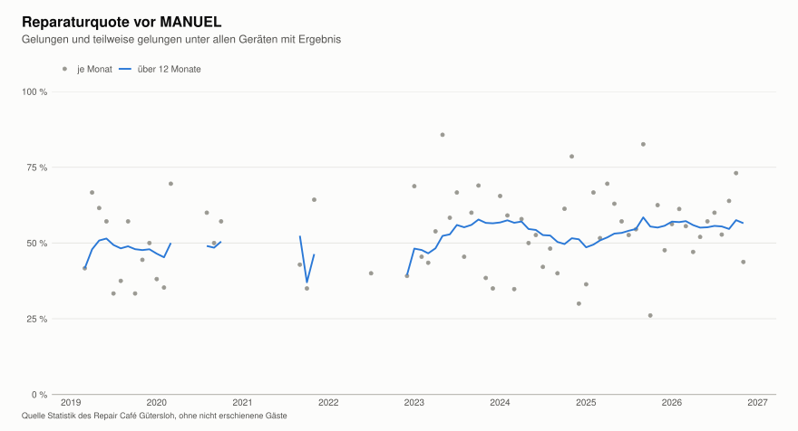
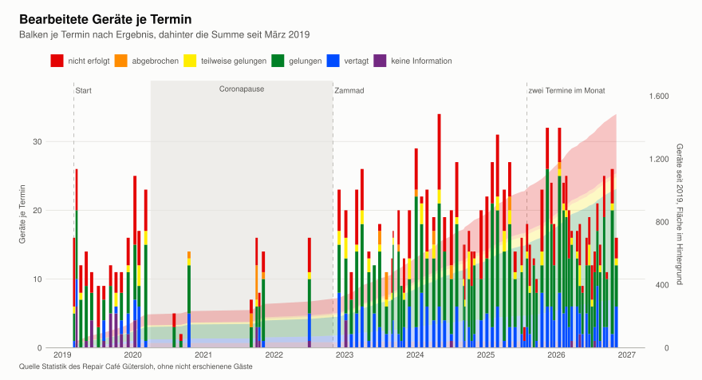
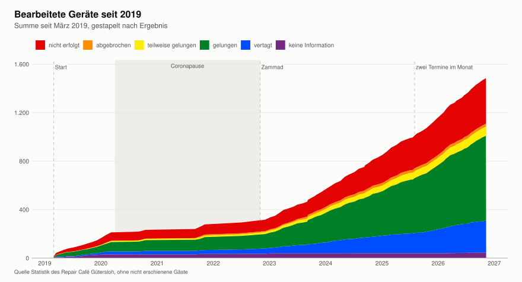
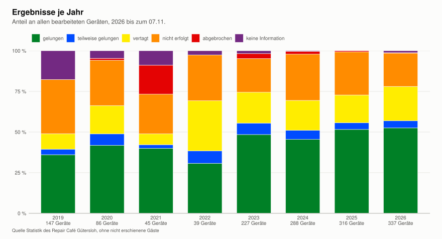
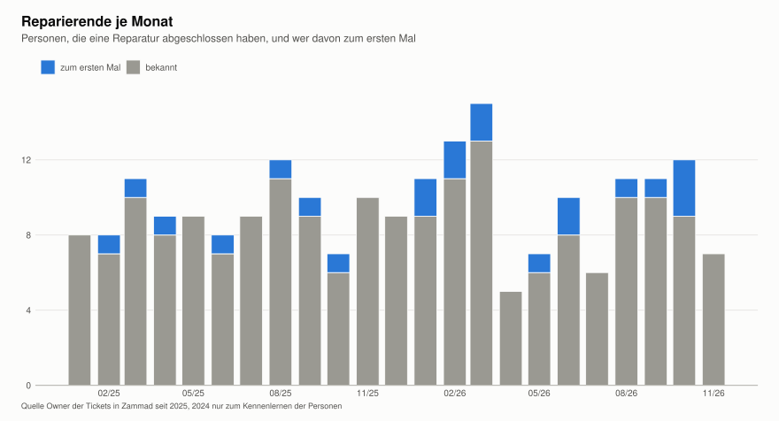

[[erprobung]]
== Erprobung im Repair Café

_Teilfrage T8. Was bewirkt MANUEL im Repair Café?_

.Auf einen Blick
====
*Worum es geht.* Was MANUEL im Repair Café bewirkt, gemessen an den vier Kennzahlen aus dem Antrag bei der DSEE.

*Ergebnis.*

* Steht aus. Die Erprobung läuft vom 05.12.2026 bis Februar 2027 mit fünf Terminen.
* Gemessen wird an den vier Kennzahlen aus dem Antrag bei der DSEE <<adr-0032>>.
* Die Vergleichswerte stammen aus der Zeit vor MANUEL.
* Drei Monate mit rund zwei Terminen im Monat ergeben kleine Zahlen. Jede Quote bekommt deshalb ein Intervall nach Wilson cite:[wiki-wilson].

*Wichtigste Befehle.* Keine, dieses Kapitel hat noch keine eigenen Aufrufe.
====

[NOTE]
.Entwurf in Stichpunkten, Stand 2026-11-08
====
Dieses Kapitel entsteht während der Erprobung von Dezember 2026 bis Februar 2027.
====

=== Zeitraum und Termine

* Echtbetrieb ab dem 05.12.2026 mit den Terminen am 05.12., 19.12., 16.01., 06.02. und 20.02. Der 02.01. fällt in die Winterpause.
* Steigt MANUEL nach <<adr-0040>> von Zammad auf n8n um, weist die Fallstudie die Zeit davor und danach getrennt aus.
* Was in dieser Zeit läuft und was noch nicht

=== Reparaturquote

* Anteil gelungener Reparaturen an den bearbeiteten Geräten aus dem Feld Ergebnis
* Vergleichswerte aus der Statistik des Teams

[cols="1,1,1,1",options="header"]
|===
|Jahr |bearbeitet |gelungen |teilweise gelungen
|2023 |227 |48 % |7 %
|2024 |288 |45 % |6 %
|2025 |316 |52 % |4 %
|2026 bis 7.11. |337 |53 % |4 %
|===

* Weitere Vergleiche sind `repair_status` der Open Repair Data und das Ergebnis der Laufzettel von 2019 bis 2021.

==== Stand vor MANUEL

Festgelegt am 22.11.2026 für drei Zeiträume bis zum 07.11.2026, den letzten Termin vor dem Start. Die Quote zählt gelungen und teilweise gelungen unter allen Geräten mit Ergebnis, also ohne nicht erschienene Gäste und ohne „keine Information“. Teilweise gelungen zählt wie in den Open Repair Data als gelungen.

[cols="2,1,1,1",options="header"]
|===
| |seit 2019 |36 Monate |12 Monate
|Termine |85 |49 |20
|bearbeitete Geräte |1.485 |961 |379
|Geräte je Termin |17,5 |19,6 |19,0
|Reparaturquote |53,8 % |54,6 % |56,5 %
|davon teilweise gelungen |9,7 % |9,0 % |7,1 %
|nicht erschienen |6,5 % |6,9 % |7,3 %
|Reparierende je Monat |9,5 |9,5 |9,8
|davon zum ersten Mal |0,9 |0,9 |1,2
|===

Reparierende gibt es erst seit 2025, als Owner der Tickets. Der Owner ist die Person, die die Reparatur abgeschlossen hat, nicht jede, die mitgeholfen hat. Für 36 Monate und seit 2019 stehen dort deshalb nur die 23 Monate ab Januar 2025. Reparaturen durch Gäste und Rückmeldungen zu Vorschlägen gibt es vor MANUEL nicht, ihr Stand ist 0. Gemeldet sind 2 Prozent, falsche Arten im Vorabtest 17,5 Prozent <<adr-0040>>. Die Zahlen stehen in {repo}/eval/results/indicators/baseline-2026-11-22/baseline.csv[baseline.csv].

=== Reparaturen durch Gäste und neue Engagierte

* Wer repariert hat, ist in Zammad Owner der Reparatur und hat die Rolle Repair Agent.
* Hat der Gast selbst repariert, ist der Agent Gast Owner. Er zählt nicht als reparierende Person. Eine Reparatur mit Hilfe ist nicht eigens erkennbar.
* Neu ist, wer in einem Monat zum ersten Mal eine Reparatur abschließt. Statt eines Stichtags zeigt das Diagramm die Entwicklung je Monat.

=== Rückmeldungen zu den Vorschlägen

* Zwei Makros, „Vorschlag hilfreich“ und „Vorschlag nicht hilfreich“, setzen mit einem Klick einen Tag, beim zweiten mit einer kurzen Notiz <<adr-0032>>.
* Die Checkliste jeder Reparatur hat dafür einen eigenen Punkt, „Vorschläge von MANUEL geprüft und als hilfreich oder nicht hilfreich markiert“ <<adr-0060>>.
* Die KI-Rückmeldung von Zammad reicht nicht. Nach dem Erzeugen eines Textes lässt er sich dort nicht mehr bewerten, nur noch per Notiz kommentieren cite:[zammad-feedback].
* Stimmen und Beispiele aus den Notizen, ohne Personenbezug
* Das Fehlerprotokoll zeigt, wie oft Anfragen ausgefallen sind.

=== Gemeldete Reparaturen

* Anteil der an Restarters übertragenen Geräte an den bearbeiteten, Ausgangswert 30 von 1.485, also rund 2 Prozent
* Mit und ohne Nachmeldung nach <<adr-0036>> getrennt ausgewiesen

=== Weitere Zahlen über die Zeit

* Bearbeitete Geräte je reparierender Person und Termin, über die Jahre. Die Reparierenden zählen wir aus Zammad, wo jede Person einer Reparatur zugeordnet ist.
* Geräte je Gast, also wie viele Geräte eine Person im Schnitt mitbringt. Gezählt wird lokal, in die Fallstudie kommen nur Summen.
* Diese Zahlen gehören nicht zu den Kennzahlen des Antrags, sie ordnen die Erprobung aber ein.

=== Vertagte Geräte

* Wie viele vertagte Geräte kommen wieder, nach wie vielen Terminen, und wie geht es aus? Wir wollen wissen, ob Geräte am Ende repariert werden oder ob Gäste das Interesse verlieren, wenn es zu lange dauert.
* Die Grundlage sind die Tags mit dem Datum je Termin <<adr-0036>>. 2025 und 2026 tragen 44 Tickets mehr als ein Datum.

=== Sharecards der Termine

* Die Karten der Termine in der Erprobung als Abbildungen <<adr-0033>>

// Ergebnis folgt in Stufe 3, Antwort auf T8.

.Zum Nachvollziehen
****
* Exporte aus Zammad und die Statistik bleiben lokal, hier stehen nur Summen.
* Entscheidungen <<adr-0032>>, <<adr-0033>>, <<adr-0036>>
****

[NOTE]
.Quellen und offene Punkte für dieses Kapitel
====
* cite:[wiki-wilson], cite:[zammad-feedback]
* Noch zu suchen sind Hinweise zur Auswertung kleiner Stichproben über die Intervalle hinaus.
* Offen ist, wie zuverlässig die Makros genutzt werden. Das zeigen die ersten Termine.
====
