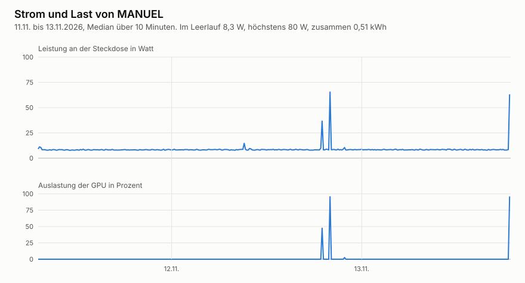

[[kosten]]
== Kosten und Vergleich mit der Cloud

_Teilfrage T10. Was kostet MANUEL im Jahr an Strom, Geld und Pflege?_ +
_Teilfrage T11. Was verlieren wir durch den lokalen Betrieb?_

.Auf einen Blick
====
*Worum es geht.* Was MANUEL im Jahr an Strom, Geld und Pflege kostet und was wir gegenüber einem Modell in der Cloud verlieren.

*Ergebnis.*

* Seit dem 11.11.2026 misst eine Steckdose NOUS A1T den Strom, ein Logger hält jede Minute die Werte fest. Im Leerlauf braucht MANUEL rund 8 W, in den ersten 2,5 Tagen zusammen 0,51 kWh, also rund 0,2 kWh am Tag.
* Die Kosten bestehen aus Anschaffung, Strom und der Zeit für die Pflege.
* Ein Cloud-Modell bekommt zum Vergleich nur öffentliche oder erfundene Daten, echte Tickets bleiben lokal.

*Wichtigste Befehle.*

[source,bash]
----
tail -n 3 /var/log/manuel/metrics-$(date +%Y-%m).csv
sudo python3 /usr/libexec/manuel/status_check.py --dry-run
----
====

[NOTE]
.Entwurf in Stichpunkten, Stand 2026-11-08
====
Dieses Kapitel entsteht mit den Messungen während der Erprobung.
====

=== Anschaffung und Strom

* Anschaffung laut Antrag bei der DSEE
* Strom im Leerlauf und unter Last an der Steckdose gemessen, auf ein Jahr hochgerechnet

.Strom und Last von MANUEL, gemessen an der Steckdose

* Vom 11. bis 13.11.2026 lag die Leistung im Leerlauf im Median bei 8,3 W. Spitzen bis 80 W entstehen, wenn ein Modell rechnet, gut zu sehen an der Auslastung der GPU darunter.
* Hochgerechnet ergibt der Leerlauf rund 75 kWh im Jahr. Wie viel die Termine des Repair Café dazu beitragen, zeigen die Messungen während der Erprobung.
* Die Messwerte liegen in {repo}/docs/messungen/metrics-2026-11.csv[docs/messungen], die Grafik entsteht mit {repo}/eval/strom/power_chart.py[power_chart.py].
* Gemessen wird mit einer Steckdose NOUS A1T mit Tasmota. Ein Logger auf MANUEL hält jede Minute Strom, Auslastung, Speicher und Temperaturen fest, siehe {repo}/docs/inbetriebnahme.md[Inbetriebnahme], Schritt 8. Über Beginn und Ende in `lauf.json` lassen sich Strom und Last einem Lauf zuordnen.
* Strompreis am Tag der Messung
* Generative Modelle brauchen für dieselbe Aufgabe deutlich mehr Energie als spezialisierte Modelle cite:[luccioni-2024]. Das spricht dafür, kleine Modelle wie `d3:9b` für das Einordnen zu nutzen.

=== Pflege

* Zeit für Katalog, Modelle, Updates und Fehler, vom Team während der Erprobung mitgeschrieben
* Updates des Images laufen täglich und automatisch <<adr-0016>>.

=== Vergleich mit einem Cloud-Modell

* Dieselbe Einordnung mit demselben Prompt und derselben Vorauswahl an den 279 Laufzetteln von 2019 bis 2021 und den 83 erfundenen Tickets
* Anbieter und Modell legt ein eigenes ADR fest, wenn der Versuch ansteht.
* Verglichen werden Trefferquote, Dauer und Kosten je Anfrage.

=== Was wir gewinnen und verlieren

* Gewinn sind Datenschutz, Unabhängigkeit und feste Kosten.
* Verlust kann Qualität oder Geschwindigkeit sein, das zeigt der Vergleich.

// Ergebnis folgt in Stufe 3, Antwort auf T10 und T11.

.Zum Nachvollziehen
****
* Messungen zur Geschwindigkeit in {repo}/docs/benchmarks.md[docs/benchmarks.md]
* Entscheidungen <<adr-0002>>, <<adr-0016>>, <<adr-0023>> bis <<adr-0025>>
****

[NOTE]
.Quellen und offene Punkte für dieses Kapitel
====
* cite:[luccioni-2024]
* Noch zu suchen sind aktuelle Strompreise und die Preise der Cloud-Anbieter am Tag der Messung.
* Der Strom wird seit dem 11.11.2026 gemessen. Offen sind die Last während der Erprobung und die Wahl des Cloud-Modells.
====
