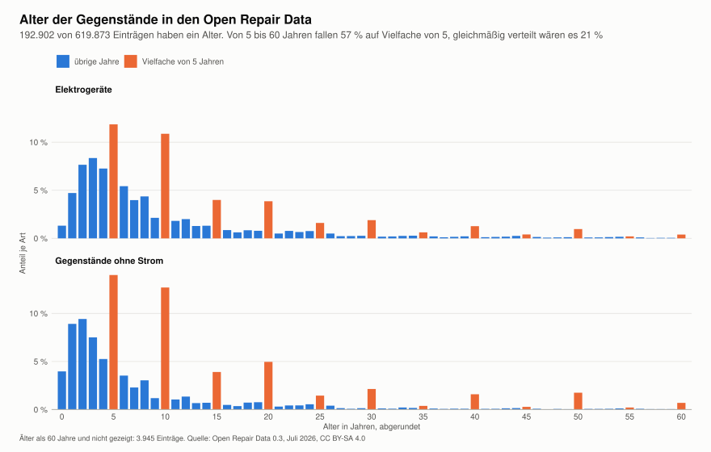
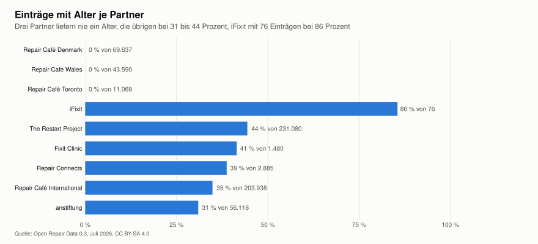

[appendix]
[[anhang-ords]]
== Felder des Open Repair Data Standard

:ords: https://github.com/openrepair/datastandard/blob/c1a1f2979937a3a481782d3afbde1b62f9b24b58/standard.rst

Dieser Anhang beschreibt alle Felder des Open Repair Data Standard in Version 0.3 cite:[ora-standard]. Bedeutung, Zweck und Erfassung sind aus dem Standard übersetzt und zusammengefasst. Jedes Feld verlinkt auf die Zeilen im Quelltext des Standards, Stand Commit `c1a1f29`. Unter „Bei uns“ steht, woher der Wert im Repair Café Gütersloh kommt. Wir melden über Restarters.net <<adr-0014>>. Für die Open Repair Data ist deshalb The Restart Project der Partner, der unsere Daten liefert, und nicht die anstiftung.

Pflicht und optional stehen in der Übersicht des Standards {ords}#L62-L117[(Zeile 62 bis 117)], Namen und Datentypen in der Feldreferenz {ords}#L383-L478[(Zeile 383 bis 478)].

=== Zum Gerät

==== Kategorie des Partners, `partner_product_category`, Pflicht

[horizontal]
Bedeutung:: Die ursprüngliche Kategorie aus den Daten des Partners, also die Kategorie, die einer ORDS-Kategorie zugeordnet wird. Eine Option aus der Liste des Partners oder Freitext.
Zweck:: Neben der ORDS-Kategorie erlaubt sie andere Auswertungen. Außerdem lassen sich Fehler, Übersetzungsprobleme, Mehrdeutigkeiten und Ermessensfragen in der Zuordnung finden und die Qualität der Daten verbessern.
Erfassung:: Die Partner haben schon immer eigene Kategorien geliefert. Die Alliance ordnet sie von Hand in Google Sheets zu cite:[ora-datasets]. Am wertvollsten sind einheitliche Kategorien aus einer festen Werteliste, die schon bei der Erfassung geprüft und im besten Fall bereits einer ORDS-Kategorie zugeordnet sind. Manche kommen als Freitext oder nicht auf Englisch. Oft wird die Kategorie mit einem weiteren Feld wie `item_type` verkettet, etwa „Household appliances electric ~ Coffee maker“. Das hilft bei der Zuordnung.
Bei uns:: Die Kategorie bei Restarters und der englische Name des Gegenstands als `item_type`, in den Daten etwa „Coffee maker ~ Bean-to-cup coffee machine“ für einen Kaffeevollautomaten. Beides kommt aus den Spalten `restarters_category` und `name_en` des Katalogs <<adr-0013>>. Bis 2025 kamen unsere 30 Laufzettel über die anstiftung, dort in der Form „Haushaltsgeräte ~ Waschmaschine“.
Fundstelle:: {ords}#L159-L181[Zeile 159 bis 181]

==== Produktkategorie, `product_category` und `product_category_id`, optional

[horizontal]
Bedeutung:: Ein Wert aus der Liste der ORDS-Kategorien. Die Liste ist eine verkleinerte Auswahl aus den Gegenständen aller Partner, die bei Reparaturveranstaltungen regelmäßig vorkommen oder für die Politik wichtig sind. Was in keine Kategorie passt, kommt in eine Sammelkategorie wie „Small home electrical“ oder „Misc“.
Zweck:: Auswertungen je Kategorie oder für mehrere Kategorien zusammen. Reparaturquoten und Hindernisse lassen sich zwischen Kategorien vergleichen und in politische Debatten über bestimmte Produkte einbringen.
Erfassung:: Die Werte werden meist nicht erfasst, sondern aus der Kategorie des Partners zugeordnet. Für Gegenstände ohne Strom legt der Standard keine Werte fest. Er konzentriert sich auf Elektrogeräte, weil sie häufiger vorkommen und politisch auf absehbare Zeit am wichtigsten sind.
Bei uns:: Die Zuordnung macht die Open Repair Alliance. Der Katalog führt die ORA-Gruppe trotzdem in der Spalte `ora_group`, damit jede Kategorie eindeutig einer Gruppe zugeordnet ist. Die 40 Gruppen mit Strom stehen im Standard, die 6 Gruppen ohne Strom nur in den Daten, siehe <<ords>>.
Fundstelle:: {ords}#L127-L157[Zeile 127 bis 157], Liste der Werte {ords}#L482-L592[Zeile 482 bis 592]

==== Marke, `brand`, optional

[horizontal]
Bedeutung:: Die Marke des Gegenstands, wenn sie erkennbar ist. Freitext.
Zweck:: Zusammenhang zwischen der Bauweise einzelner Hersteller und der Reparierbarkeit ihrer Produkte.
Erfassung:: Die Marke ist nicht immer erkennbar, manche Gegenstände sind No-Name-Ware.
Bei uns:: Feld Marke in Zammad, in den Tickets von 2024 bis 2026 bei rund 25 Prozent gefüllt. Künftig hilft das Foto vom Typenschild <<adr-0034>>. In den Open Repair Data steht bei 37,9 Prozent der Elektrogeräte „Unknown“. Dort ist also nicht zu unterscheiden, ob ein Gerät keine Marke hat oder ob sie nur nicht erfasst wurde. Auch die Markenliste der anstiftung hat keinen Wert für „ohne Marke“.
Fundstelle:: {ords}#L183-L193[Zeile 183 bis 193]

==== Alter und Baujahr, `product_age` und `year_of_manufacture`, optional

[horizontal]
Bedeutung:: Das geschätzte Alter des Gegenstands, als er vorgestellt wurde, in Jahren mit höchstens einer Nachkommastelle. Das Baujahr ist das ungefähre Jahr der Herstellung. Jedes der beiden Felder lässt sich aus dem anderen und dem Datum des Termins berechnen.
Zweck:: Wie alt Gegenstände bei der Reparatur sind. Daraus lassen sich Lebensdauer und Haltbarkeit von Kategorien oder Marken abschätzen.
Erfassung:: Beides ist schwer genau zu erfassen. Oft schätzt der Gast, und manchmal ist es nur die Zeit, die er den Gegenstand besitzt. Die Werte gelten deshalb nur als Schätzung.
Bei uns:: Feld Baujahr in Zammad, in den Tickets von 2024 bis 2026 nie gefüllt. Das ungefähre Alter soll künftig die Nachfrage beim Gast klären.
Fundstelle:: {ords}#L195-L214[Zeile 195 bis 214]

In den Open Repair Data vom Juli 2026 sind Alter und Baujahr immer gemeinsam gefüllt und passen immer zum Jahr des Termins. Eines der beiden Felder ist also aus dem anderen berechnet, wie es die Feldreferenz erlaubt. Nur 192.902 von 619.873 Einträgen haben ein Alter, drei Partner liefern nie eines. Das mittlere Alter liegt bei 7 Jahren.

Dass die Werte Schätzungen sind, zeigt die Verteilung. Von 5 bis 60 Jahren fallen 57 Prozent der Alter auf Vielfache von 5, bei gleichmäßiger Verteilung wären es 21 Prozent. Gäste sagen also eher „etwa 10 Jahre“ als „9 Jahre“. 396 Einträge sind älter als 100 Jahre. Viele davon sind plausibel, etwa Pendeluhren, Familienbibeln, Möbel oder Nähmaschinen. Andere sind es nicht, etwa ein Toaster von 1869, ein Verstärker von 1771 oder ein Elektrogerät von 1671. Die Alliance prüft das Baujahr nach eigener Aussage auf negative Alter, Tippfehler und verdächtige Werte cite:[ora-datasets]. Die Werte von 1671 und 1771 haben diese Prüfung trotzdem überstanden. Für Auswertungen des Alters sollten solche Ausreißer deshalb begrenzt oder einzeln geprüft werden.

.Alter der Gegenstände in den Open Repair Data

.Einträge mit Alter je Partner

Die Zahlen stammen aus {repo}/eval/ora/age.R[age.R], ausgewertet in R nach <<adr-0049>>. Alle Werte des Felds mit Anzahl stehen in {repo}/docs/ora/fields/product_age.tsv[product_age.tsv].

=== Zur Reparatur

==== Ergebnis, `repair_status`, Pflicht

[horizontal]
Bedeutung:: Das Ergebnis des Reparaturversuchs am Termin. „Fixed“, wenn Reparierende und Gast zufrieden sind, dass der Gegenstand weiter genutzt werden kann. „Repairable“, wenn die Reparatur nicht abgeschlossen ist, aber klar ist, welche weiteren Schritte oder welche fachliche Hilfe nötig sind. „End of life“, wenn beide entscheiden, dass sich eine Reparatur nicht lohnt oder nicht machbar ist. Ein leerer Wert gilt als „Unknown“.
Zweck:: Reparaturquoten der Gegenstände bei Reparaturveranstaltungen. Zusammen mit Kategorie und Hindernis zeigt es, welche Produkte sich im Ehrenamt am schwersten reparieren lassen und warum.
Erfassung:: Die meisten Partner erfassen das Ergebnis schon, ihre Werte müssen aber zugeordnet werden. Repair Cafés erfassen es gern, weil sie damit Engagierten und Fördernden ihren Erfolg zeigen können.
Bei uns:: Feld Ergebnis in Zammad. Gelungen wird „Fixed“, vertagt wird „Repairable“, nicht erfolgt und abgebrochen werden „End of life“. Teilweise gelungen klärt das Team im Einzelfall, siehe {repo}/eval/restarters/backfill.py[backfill.py].
Fundstelle:: {ords}#L219-L242[Zeile 219 bis 242]

==== Problem, `problem`, Pflicht

[horizontal]
Bedeutung:: Eine Beschreibung des Problems, das bei der Reparatur am Gerät festgestellt wurde. Freitext ohne personenbezogene Daten wie Mailadressen.
Zweck:: Häufige Probleme zeigen, wo Hersteller nachbessern könnten oder welche Ersatzteile am dringendsten gebraucht werden.
Erfassung:: Alle Partner erfassen Probleme, bisher als Freitext. Das macht die Auswertung schwer. Eine Liste von Fehlerarten soll in einer späteren Version folgen.
Bei uns:: Felder Defekt und Lösung in Zammad. Bei der Meldung wird die Lösung an den Defekt angehängt, die Anonymisierung entfernt persönliche Angaben <<adr-0036>>. Die Alliance nennt Namen und Mailadressen in den Daten der Partner als gefundenes Problem, beschreibt aber kein Verfahren dagegen cite:[ora-datasets]. Die eigene Anonymisierung vor der Meldung bleibt deshalb nötig <<adr-0048>>. Gemeint ist laut Standard der festgestellte Fehler und nicht die Schilderung des Gastes vor dem Termin. Die Datenpotenzialanalyse hat 2022 eine Liste von 22 Defektwerten bestimmt cite:[prange-2022].
Fundstelle:: {ords}#L244-L258[Zeile 244 bis 258]

==== Hindernis, `repair_barrier_if_end_of_life`, optional

[horizontal]
Bedeutung:: Ein Wert nur bei „End of life“. Ersatzteile nicht erhältlich, Ersatzteile zu teuer, Gerät lässt sich nicht öffnen, Reparaturinformationen nicht verfügbar, Werkzeug fehlt oder Gegenstand zu abgenutzt.
Zweck:: Wichtig für politische Debatten, weil es die häufigsten Hindernisse zeigt. Die Liste entstand im Gespräch mit iFixit nach europäischen Gesetzgebungsverfahren.
Erfassung:: Ältere Problemtexte geben manchmal einen Wert her. Seit 2021 passen die Partner ihre Erfassung an.
Bei uns:: Der Grund im Feld Ergebnis, etwa „nicht erfolgt::Ersatzteil zu teuer“. Fünf Gründe entsprechen genau einem Hindernis. „Abnutzung zu groß“ entspricht dem sechsten, das die API von Restarters aber nicht annimmt.
Fundstelle:: {ords}#L260-L286[Zeile 260 bis 286]

=== Zum Termin

==== Kennung, `id`, Pflicht

[horizontal]
Bedeutung:: Eindeutige Kennung des Eintrags beim Partner. Sie muss nicht über alle Partner eindeutig sein.
Zweck:: Unverzichtbar für das Zusammenführen und für Auswertungen.
Erfassung:: Die meisten Partner haben eindeutige Kennungen. Ein Zeitstempel als Kennung war in wenigen Fällen nicht eindeutig, besser ist eine Kennung unabhängig vom Datum.
Bei uns:: Restarters vergibt die Kennung beim Anlegen des Geräts. Die Alliance fordert bei jeder Lieferung alle Daten seit Beginn an, weil Partner alte Einträge ändern oder löschen, und die Kennung bleibt dabei gleich cite:[ora-datasets]. Fehler in der Nachmeldung lassen sich also auch später noch korrigieren.
Fundstelle:: {ords}#L291-L302[Zeile 291 bis 302]

==== Datum des Termins, `event_date`, Pflicht

[horizontal]
Bedeutung:: Datum der Reparaturveranstaltung.
Zweck:: Entwicklungen über die Zeit, etwa der Anteil bestimmter Kategorien oder die Reparaturquote.
Erfassung:: Die meisten Partner kennen die Daten ihrer Termine.
Bei uns:: Feld Termin in Zammad. Jedes Gerät wird beim passenden Event auf Restarters angelegt.
Fundstelle:: {ords}#L304-L314[Zeile 304 bis 314]

==== Land, `country`, Pflicht

[horizontal]
Bedeutung:: Das Land, in dem die Veranstaltung und damit der Reparaturversuch stattfand, als Code mit drei Buchstaben nach ISO, etwa „DEU“.
Zweck:: Vergleiche zwischen Ländern, etwa der Reparaturquote oder der Hindernisse.
Erfassung:: Leicht anzugeben, wenn bekannt ist, wo die Gruppe arbeitet. Fehlt das Land, nimmt die Alliance das Land des Partners an.
Bei uns:: DEU, aus dem Ort unserer Gruppe auf Restarters.
Fundstelle:: {ords}#L316-L334[Zeile 316 bis 334]

==== Gruppe, `group_identifier`, optional

[horizontal]
Bedeutung:: Eindeutiger Name, Nummer oder Code der Gruppe, die repariert hat.
Zweck:: Hilfreich bei Auswertungen.
Erfassung:: Die meisten Partner können ihre Gruppen benennen. Ohne Untergruppen steht der Name des Partners. Ein Code oder eine Nummer genügt, der Name muss nicht genannt werden.
Bei uns:: Unsere Gruppe auf Restarters. Die anstiftung meldet nur Nummern, Restarters den Namen der Gruppe.
Fundstelle:: {ords}#L336-L347[Zeile 336 bis 347]

=== Zum Partner

==== Partner, `data_provider`, Pflicht

[horizontal]
Bedeutung:: Der Partner, der die Daten liefert, als Wert aus einer festen Liste.
Zweck:: Auswertungen je Partner.
Erfassung:: Meist klar, die Partner dürfen die genaue Schreibweise selbst festlegen.
Bei uns:: The Restart Project, weil wir über Restarters melden.
Fundstelle:: {ords}#L352-L361[Zeile 352 bis 361]

==== Datum der letzten Änderung, `record_date`, optional

[horizontal]
Bedeutung:: Wann der Eintrag in der Datenbank des Partners zuletzt geändert wurde. Das ist nicht unbedingt der Tag der Reparatur.
Zweck:: Erleichtert das Zusammenführen, weil sich geänderte Einträge seit dem letzten Mal erkennen lassen.
Erfassung:: Mit einem elektronischen System leicht zu erfassen.
Bei uns:: Setzt Restarters. In den veröffentlichten Open Repair Data fehlt dieses Feld.
Fundstelle:: {ords}#L363-L377[Zeile 363 bis 377]

=== Was der Standard nicht kennt

Einige Felder, die wir in Zammad erfassen, hat der Standard nicht.

[horizontal]
Stromversorgung:: Der Standard kennt kein Feld dafür. Er unterscheidet nur Elektrogeräte und Gegenstände ohne Strom, über die Produktkategorie und zwei getrennte Dateien. Die anstiftung fragt im Laufzettel nach mit Netzteil, 230 V, Batterie, Akku oder ohne Kabel, und Restarters kennt je Kategorie nur, ob sie Strom braucht. Bei uns bleibt das Feld trotzdem wichtig. Es entscheidet über Gefahren und die Prüfung nach VDE 0701/0702, siehe <<reparaturansaetze>>. Für die Meldung zählt nur, ob ein Gegenstand Strom braucht, und das folgt aus der Spalte `power` des Katalogs.
Lösung:: Kein eigenes Feld. Sie wird bei der Meldung an das Problem angehängt.
VDE-Prüfung, Spenden und Bedarf:: Nur für uns, für die Sicherheit und die Statistik je Termin.
Repariert von:: Kein eigenes Feld. Wer repariert hat, ist Owner des Tickets, bei Reparaturen durch den Gast selbst der Agent Gast. Das zählt für die Kennzahlen der Erprobung <<adr-0032>>.
