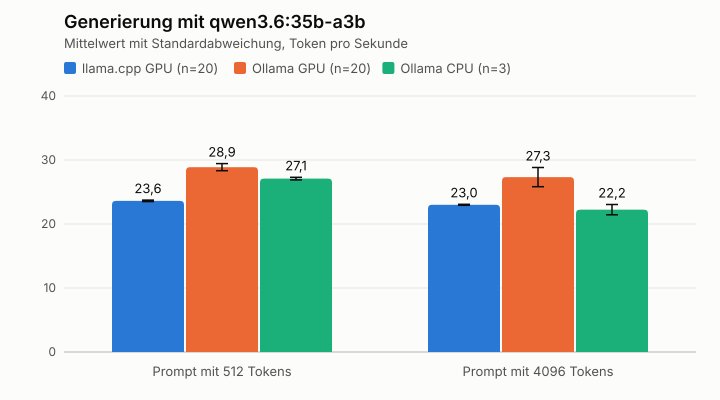
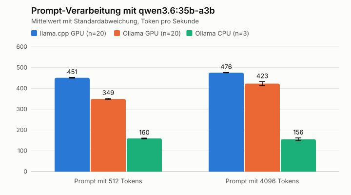
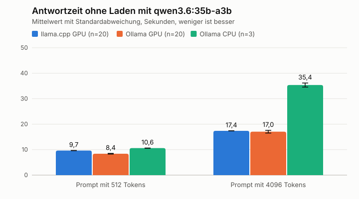
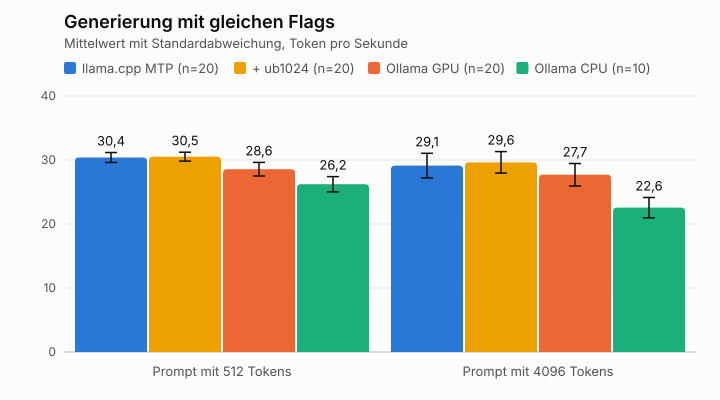
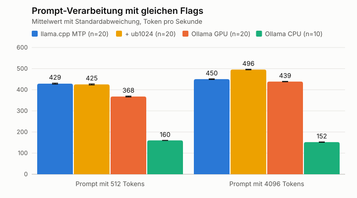
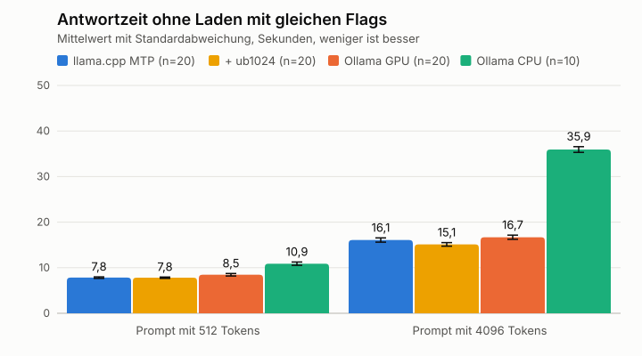
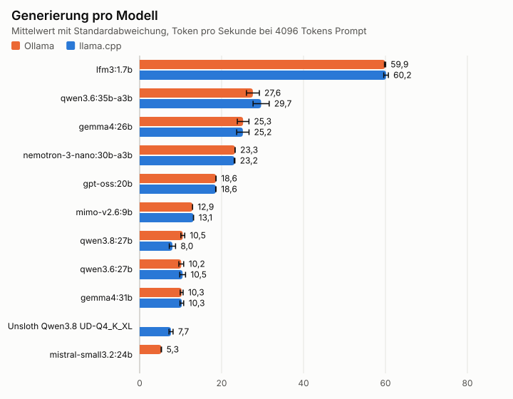
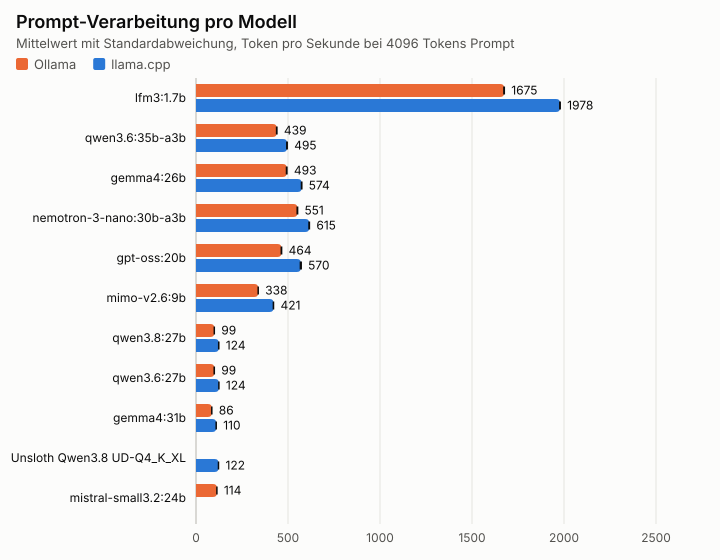
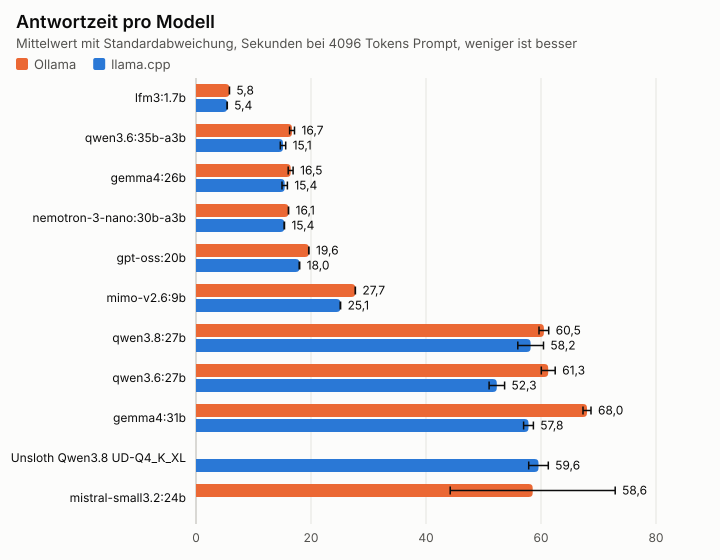
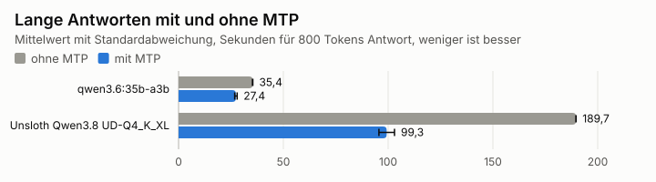

# Benchmarks

Hier halten wir fest, wie schnell MANUEL mit welcher Konfiguration läuft. Den Ablauf beschreibt Schritt 5 in der [Inbetriebnahme](inbetriebnahme.md), das Messskript liegt in [eval/bench.sh](../eval/bench.sh).

Die Benchmarks messen nur die Geschwindigkeit. Ob ein Modell gut antwortet, zeigt erst der Testsatz aus Phase 3 im [Plan](../PLAN.md).

## Testsystem

| Bestandteil | Wert |
|---|---|
| Gerät | MINISFORUM AI X1 Pro-370 mit AMD Ryzen AI 9 HX 370 und Radeon 890M |
| Arbeitsspeicher | 64 GB DDR5 mit 5600 MHz laut BIOS, davon 60 GiB für das System |
| Grafikspeicher | 2 GiB UMA und 30 GiB GTT in Runde 1 und 2, seit dem 06.11.2026 abends 16 GiB UMA und 23 GiB GTT |
| Betriebssystem | uCore Minimal auf Basis von Fedora CoreOS 44.20261023.3.1 |
| Kernel | 7.2.11-200.fc44.x86_64 |
| Leistungsprofil | `Performance Mode` |
| Lüfter | Performance-Modus |
| Ollama | 0.40.14 in Runde 1, ab den `fair-*`-Läufen 0.40.15 |

## Messbedingungen

- Prompts mit 512 und 4096 Tokens aus `ollama-bench`
- Kontextlänge 32768, Temperatur 0, Seed 42, höchstens 200 Tokens Ausgabe
- 2 Läufe zum Aufwärmen und 10 gemessene Läufe
- 2 Durchgänge im Wechsel, um Einflüsse der Temperatur zu erkennen
- GPU-Last, Speicher und Temperatur alle 2 Sekunden mitgeschrieben
- 60 Sekunden Pause zwischen den Varianten

Runde 2, die langen Antworten und der Dauertest weichen in Durchgängen, Läufen oder Tokens davon ab. Das steht jeweils im Abschnitt.

## Erkenntnisse aus der Recherche

Diese Werte stammen von Dritten und sind nicht von uns nachgemessen. Abgerufen am 05.11.2026.

- Der Engpass der Radeon 890M ist die [Speicherbandbreite](https://msf.github.io/blogpost/local-llm-performance-framework13.html). Auf demselben Prozessor erreichte Vulkan dort die doppelte Generierung von ROCm, ROCm war bei der Prompt-Verarbeitung 41 Prozent schneller.
- Für Qwen3.8-27B `UD-Q4_K_XL` nennt [qwen38-mtp](https://github.com/sudoingX/qwen38-mtp) auf der 890M mit 48 GB UMA 2,7 Token pro Sekunde und mit MTP 5,7 Token pro Sekunde.
- Der Kopf für MTP steckt laut derselben Quelle in den GGUF-Dateien von Unsloth und wird mit `--spec-type draft-mtp --spec-draft-n-max 2 --parallel 1` aktiviert. Unser Image von llama.cpp kennt diese Flags.
- MTP lohnt sich bei langen Ausgaben, bei kurzen kann es sogar bremsen. Die Prompt-Verarbeitung wird etwas langsamer.

## Runde 1 Engines

Modell `qwen3.6:35b-a3b`. llama.cpp und Ollama nutzen dieselbe GGUF-Datei. Gemessen am 05.11.2026, Mediane aus je 10 Läufen und 2 Durchgängen. Beide Engines liefen mit Vulkan und Standardwerten.

Diese Runde vergleicht die Standardwerte, nicht die Engines selbst. Ollama startet intern ebenfalls `llama-server` und schaltet bei diesem Modell MTP sowie `-ub 1024` ein, außerdem lädt es den Bildteil über `--mmproj`. Unser llama.cpp lief ohne MTP. Das erklärt den Vorsprung von Ollama bei der Generierung und vermutlich den höheren GTT-Speicher. Die Rohdaten bleiben gültig, den fairen Vergleich zeigt der nächste Abschnitt.

| Messgröße | llama.cpp | Ollama |
|---|---|---|
| Generierung bei 512 Tokens Prompt | 23,6 Token/s | 28,8 Token/s |
| Generierung bei 4096 Tokens Prompt | 23,0 Token/s | 27,0 Token/s |
| Prompt-Verarbeitung bei 512 Tokens | 451 Token/s | 349 Token/s |
| Prompt-Verarbeitung bei 4096 Tokens | 476 Token/s | 427 Token/s |
| Gesamtzeit bei 512 Tokens Prompt | 9,6 s | 12,6 s |
| Gesamtzeit bei 4096 Tokens Prompt | 17,4 s | 21,3 s |
| Größter GTT-Speicher | 18,8 GiB | 21,0 GiB |

Die Gesamtzeit von Ollama enthält etwa 4,2 s Ladezeit pro Anfrage, weil der Lauf mit `keep_alive=0` lief. Das passiert im Betrieb nicht.

Zum Vergleich lief Ollama allein auf der CPU mit 12 Threads, Mediane aus je 3 Läufen. Die GPU-Last lag bei 0 Prozent.

| Messgröße | CPU | Ollama auf GPU |
|---|---|---|
| Generierung bei 512 Tokens Prompt | 27,2 Token/s | 28,8 Token/s |
| Generierung bei 4096 Tokens Prompt | 22,3 Token/s | 27,0 Token/s |
| Prompt-Verarbeitung bei 512 Tokens | 160 Token/s | 349 Token/s |
| Prompt-Verarbeitung bei 4096 Tokens | 152 Token/s | 427 Token/s |
| Ladezeit | 16 bis 19 s | 4,2 s |
| Höchste Temperatur | 74 °C | 57 °C |

Auch der CPU-Lauf nutzte MTP. Die Generierung liegt fast gleichauf, weil bei diesem MoE-Modell die Speicherbandbreite begrenzt. Die GPU lohnt sich vor allem bei der Prompt-Verarbeitung und entlastet die CPU.

Die Grafiken zeigen Mittelwerte mit Standardabweichung aller Läufe. Sie weichen deshalb leicht von den Medianen in den Tabellen ab. Die Antwortzeit ist die Gesamtzeit jedes Laufs abzüglich seiner Ladezeit. Der CPU-Lauf hat nur 3 Läufe und ist entsprechend unsicherer.







Die Rohdaten liegen in [eval/results](../eval/results), die Grafiken erzeugt [eval/plot.py](../eval/plot.py).

## Fairer Vergleich der Engines

Modell `qwen3.6:35b-a3b`, Ollama 0.40.15 mit geladenem Modell, alle GPU-Varianten mit MTP. Gemessen am 06.11.2026, Mediane aus 10 Läufen und 2 Durchgängen, die CPU aus 10 Läufen und 1 Durchgang. Die Werte stehen für Prompts mit 512 und 4096 Tokens.

| Messgröße | llama.cpp MTP | llama.cpp MTP und `-ub 1024` | Ollama GPU | Ollama CPU |
|---|---|---|---|---|
| Generierung in Token/s | 30,4 / 29,5 | 30,3 / 29,7 | 28,6 / 27,6 | 26,5 / 22,9 |
| Prompt-Verarbeitung in Token/s | 429 / 450 | 426 / 495 | 368 / 439 | 160 / 152 |
| Gesamtzeit in s | 7,8 / 16,0 | 7,9 / 15,1 | 8,4 / 16,7 | 10,8 / 35,9 |
| Größter GTT-Speicher in GiB | 19,6 | 19,9 | 21,0 | 0 |

Mit gleichen Flags liegt llama.cpp bei diesem Modell überall vorn, aber nur knapp. Die Generierung ist etwa 6 Prozent schneller, die Prompt-Verarbeitung bei langen Prompts etwa 13 Prozent. Im Alltag sind das je nach Prompt 0,5 bis 1,6 Sekunden pro Antwort. `-ub 1024` hilft nur bei langen Prompts. Der große Abstand aus Runde 1 kam also von MTP und nicht von der Engine.







## Runde 2 Modelle

Gemessen am 06.11.2026 mit Ollama 0.40.15 und llama.cpp, jeweils mit `-ub 1024` und den MTP-Flags, die Ollama für das Modell selbst wählt. Das sind 10 Läufe in 1 Durchgang. Die Liste steht in [eval/models-runde2.txt](../eval/models-runde2.txt), die Flags in [eval/results/ollama-spec-flags.txt](../eval/results/ollama-spec-flags.txt). Dazu kommt Qwen3.8-27B `UD-Q4_K_XL` von Unsloth ohne und mit MTP. Alle Werte stehen für Prompts mit 512 und 4096 Tokens.

| Modell | Engine | MTP n | Generierung in Token/s | Prompt in Token/s | Gesamtzeit in s | GTT in GiB | Höchste Temperatur |
|---|---|---|---|---|---|---|---|
| `lfm3:1.7b` | Ollama | - | 62,5 / 59,9 | 1573 / 1675 | 3,5 / 5,8 | 0,3 | 60 °C |
| `lfm3:1.7b` | llama.cpp | - | 62,8 / 60,2 | 1828 / 1978 | 3,5 / 5,4 | 0,3 | 62 °C |
| `qwen3.6:35b-a3b` | Ollama | 2 | 29,5 / 27,8 | 371 / 439 | 8,2 / 16,6 | 21,0 | 58 °C |
| `qwen3.6:35b-a3b` | llama.cpp | 2 | 30,7 / 29,8 | 427 / 495 | 7,8 / 15,1 | 19,9 | 60 °C |
| `gemma4:26b` | Ollama | 3 | 29,4 / 25,1 | 429 / 493 | 8,1 / 16,5 | 18,5 | 60 °C |
| `gemma4:26b` | llama.cpp | 3 | 29,9 / 25,0 | 474 / 574 | 8,0 / 15,4 | 17,3 | 63 °C |
| `nemotron-3-nano:30b-a3b` | Ollama | - | 23,5 / 23,3 | 407 / 551 | 9,8 / 16,1 | 21,5 | 61 °C |
| `nemotron-3-nano:30b-a3b` | llama.cpp | - | 23,4 / 23,1 | 454 / 615 | 9,7 / 15,3 | 21,5 | 62 °C |
| `gpt-oss:20b` | Ollama | - | 19,1 / 18,6 | 418 / 464 | 11,7 / 19,6 | 12,2 | 62 °C |
| `gpt-oss:20b` | llama.cpp | - | 19,0 / 18,6 | 498 / 570 | 11,6 / 18,0 | 12,2 | 64 °C |
| `mimo-v2.6:9b` | Ollama | - | 13,4 / 12,9 | 332 / 338 | 16,5 / 27,7 | 6,1 | 61 °C |
| `mimo-v2.6:9b` | llama.cpp | - | 13,5 / 13,1 | 414 / 421 | 16,2 / 25,1 | 4,9 | 67 °C |
| `qwen3.8:27b` | Ollama | 4 | 12,2 / 10,5 | 96 / 99 | 21,8 / 60,6 | 19,2 | 62 °C |
| `qwen3.8:27b` | llama.cpp | 4 | 8,4 / 7,9 | 114 / 124 | 28,1 / 58,4 | 18,1 | 69 °C |
| `qwen3.6:27b` | Ollama | 3 | 9,9 / 10,4 | 96 / 99 | 25,5 / 60,8 | 19,1 | 64 °C |
| `qwen3.6:27b` | llama.cpp | 3 | 10,2 / 10,6 | 119 / 124 | 23,9 / 52,0 | 18,0 | 69 °C |
| `gemma4:31b` | Ollama | 3 | 11,6 / 10,2 | 86 / 86 | 23,5 / 68,0 | 23,9 | 67 °C |
| `gemma4:31b` | llama.cpp | 3 | 11,7 / 10,4 | 102 / 110 | 22,7 / 57,6 | 22,7 | 71 °C |
| Unsloth Qwen3.8 `UD-Q4_K_XL` | llama.cpp | - | 4,3 / 4,2 | 119 / 127 | 50,3 / 79,2 | 17,0 | 70 °C |
| Unsloth Qwen3.8 `UD-Q4_K_XL` | llama.cpp | 2 | 8,4 / 7,7 | 115 / 122 | 28,0 / 59,4 | 18,5 | 71 °C |
| `mistral-small3.2:24b` | Ollama | - | - / 5,3 | - / 114 | - / 69,6 | 18,1 | 65 °C |

Die Tags mit `-mtp` nutzen dieselbe Datei wie das jeweilige Modell und fehlen deshalb in der Tabelle. Bei `qwen3.6:35b-a3b-mtp-q4_K_M` schwankte die Prompt-Verarbeitung von llama.cpp trotzdem zwischen 425 und 495 Token/s, und im Dauertest blieb sie innerhalb eines Laufs konstant. Der Unterschied entsteht also beim Start der Engine, die Ursache ist noch offen.

- `gemma4:26b` lief mit llama.cpp nur über den Tag mit `-mtp`, weil der erste Versuch ohne die eigene Draft-Datei für MTP scheiterte.
- `mistral-small3.2:24b` lässt sich in llama.cpp nicht laden, die Meldung lautet `wrong number of tensors; expected 585, got 363`. Der Prompt mit 512 Tokens ist für dieses Modell zu kurz. Seine Antwortzeit springt zwischen rund 42 und 70 s, der Grund ist offen.
- `qwen3.8:27b` ist die einzige Ausnahme von der Regel, dass beide Engines etwa gleich schnell generieren. Ollama kommt auf 12,2 Token/s, llama.cpp auf 8,4 Token/s, bei gleichem `n-max` von 4. Die Trefferquote von MTP lag bei rund 70 gegenüber rund 50 Prozent. Als Ursache vermuten wir die Chat-Vorlage, geprüft ist das noch nicht.
- Bei `qwen3.8:27b` mit llama.cpp brach ein Lauf von 10 mit `EOF` ab. Der Wert stammt deshalb aus 9 Läufen.
- `lfm3:1.7b` ist mit Abstand am schnellsten und passt fast ganz in die 2 GiB UMA.







Die Modelle teilen sich in zwei Gruppen. Bei langen Prompts brauchen `qwen3.6:35b-a3b`, `gemma4:26b` und `nemotron-3-nano:30b-a3b` um 16 Sekunden. Die großen Modelle `qwen3.8:27b`, `qwen3.6:27b` und `gemma4:31b` brauchen eine knappe Minute oder mehr.

## MTP bei langen Antworten

Lange Antworten entsprechen einer Reparaturanleitung. Gemessen mit llama.cpp und 800 Tokens Ausgabe, 512 Tokens Prompt, Median aus 10 Läufen.

| Modell | Generierung ohne MTP | Generierung mit MTP | Gesamtzeit ohne MTP | Gesamtzeit mit MTP |
|---|---|---|---|---|
| `qwen3.6:35b-a3b` | 23,4 Token/s | 30,9 Token/s | 35,4 s | 27,2 s |
| Unsloth Qwen3.8 `UD-Q4_K_XL` | 4,3 Token/s | 8,3 Token/s | 189,7 s | 100,2 s |

MTP bringt bei Qwen 3.6 etwa 32 Prozent und bei Qwen 3.8 etwa 93 Prozent mehr Tempo. Die Prompt-Verarbeitung sinkt dabei um 3 bis 5 Prozent, die Zeit bis zum ersten Token bleibt fast gleich. Das Tempo schwankt mit MTP stärker, weil die Trefferquote vom Text abhängt.



## Dauertest

`qwen3.6:35b-a3b` mit Ollama, 90 Läufe mit 4096 Tokens Prompt am Stück, rund 26 Minuten bei 97 Prozent GPU-Last.

| Abschnitt | 1. Sechstel | 2. | 3. | 4. | 5. | 6. |
|---|---|---|---|---|---|---|
| Generierung in Token/s | 28,1 | 28,0 | 28,4 | 28,4 | 27,3 | 28,9 |
| Prompt-Verarbeitung in Token/s | 441 | 441 | 441 | 441 | 442 | 441 |
| Temperatur im Mittel | 55,9 °C | 58,3 °C | 58,8 °C | 59,1 °C | 59,3 °C | 60,0 °C |

Es gibt keine Drosselung. Die Temperatur erreichte höchstens 62 °C, die Prompt-Verarbeitung blieb zwischen 439 und 443 Token/s. Die Generierung streute zwischen 22,6 und 30,9 Token/s ohne Trend über die Zeit.

## Flash-Next

Qwen3.8-Flash-Next `UD-IQ1_S` ist mit rund 62 GiB größer als der nutzbare Arbeitsspeicher. Das Modell ließ sich auf diesem Gerät nicht starten.

- Auf der GPU brach das Laden nach 3 Sekunden mit `Not enough memory for command submission` ab, das GTT-Limit liegt bei 30 GiB.
- Auf der CPU beendete der Kernel `llama-server` nach etwa 18 Sekunden mit `Out of memory`. Warum das schon bei 27,8 GiB anonymem Speicher geschah, ist nicht geklärt. Die Meldung liegt in `results/flash-cpu`.

In beiden Fällen lief das System ohne Neustart weiter. Das Modell scheidet für MANUEL aus.

## Speicherbedarf

Mitgeschrieben wurde nur der Grafikspeicher. Die Spitze lag bei 25,7 GiB für `gemma4:31b` mit Ollama, also 1,8 GiB UMA und 23,9 GiB GTT. Das GTT-Limit von 30 GiB war damit zu höchstens 80 Prozent ausgelastet. Der Gesamtspeicher fehlt in den Rohdaten. Eine Momentaufnahme im Dauertest zeigte 31 GiB belegt, davon 23 GiB Grafikspeicher. Außer beim Versuch mit Flash-Next gab es keinen Speichermangel, der Swap blieb praktisch ungenutzt.

## Runde 3 UMA

Gemessen am 06.11.2026 mit 16 GiB UMA statt 2 GiB, gleiche Flags wie in Runde 2. Die großen Modelle liefen mit 5 statt 10 Läufen. Der Kernel bleibt unverändert, das GTT-Limit folgt von selbst dem freien Speicher.

| Speicher | 2 GiB UMA | 16 GiB UMA |
|---|---|---|
| GTT-Limit | 30,2 GiB | 23,3 GiB |
| Für die GPU insgesamt | 32,2 GiB | 39,3 GiB |
| Für das System | 60 GiB | 46 GiB |

Die Werte stehen für Prompts mit 512 und 4096 Tokens.

| Modell | Engine | Generierung 2 GiB | Generierung 16 GiB | Gesamtzeit 2 GiB | Gesamtzeit 16 GiB |
|---|---|---|---|---|---|
| `qwen3.6:35b-a3b` | llama.cpp | 30,7 / 29,8 | 32,2 / 30,9 | 7,8 / 15,1 | 7,4 / 14,7 |
| `qwen3.6:35b-a3b` | Ollama | 29,5 / 27,8 | 30,4 / 29,3 | 8,2 / 16,6 | 8,0 / 16,9 |
| `gemma4:31b` | llama.cpp | 11,7 / 10,4 | 12,1 / 10,6 | 22,7 / 57,6 | 21,7 / 55,9 |
| `gemma4:31b` | Ollama | 11,6 / 10,2 | 12,0 / 10,3 | 23,5 / 68,0 | 22,6 / 65,8 |
| `qwen3.8:27b` | llama.cpp | 8,4 / 7,9 | 8,6 / 7,8 | 28,1 / 58,4 | 27,5 / 60,9 |
| `qwen3.8:27b` | Ollama | 12,2 / 10,5 | 12,9 / 11,4 | 21,8 / 60,6 | 20,9 / 61,5 |

Die Generierung ist meist 2 bis 8 Prozent schneller. Das bleibt klein und liegt nah an der Streuung zwischen zwei Starts. Der eigentliche Gewinn ist der Platz. Mit 16 GiB UMA passen `qwen3.6:35b-a3b`, `d3:9b` und `bge-m3` zusammen auf die GPU, belegt sind dann 36,2 GiB Grafikspeicher und es bleiben 23 GiB `MemAvailable`. Mit 2 GiB UMA passt das nicht.

| Aufruf | Geladen | Neu laden nach Wechsel |
|---|---|---|
| Sprachmodell, 5 Tokens | 0,27 s | 26 s |
| `d3:9b`, eine Frage | 0,40 s | 13 s |
| `bge-m3` | 0,04 s | 1,6 s |

Wir bleiben deshalb bei 16 GiB UMA. Das lohnt sich auch ohne dauerhaft geladene Modelle, weil das Tempo etwas steigt. Bleiben sie geladen, entfällt zusätzlich der Wechsel.

Die Spalte für das Neuladen zeigt den Median aus 5 Wechseln mit Datei im Zwischenspeicher, `bge-m3` einmal.

Der Gesamtbedarf von `qwen3.6:35b-a3b` liegt mit llama.cpp bei rund 30 GiB, also 16 GiB UMA und etwa 14 GiB Rest. `gemma4:31b` erreicht bis zu 37 GiB.

## Decision-Modelle im Test

Gemessen am 06.11.2026 mit Ollama 0.40.15 an 83 frei erfundenen deutschen Tickets aus [eval/decision/tickets.tsv](../eval/decision/tickets.tsv). Die Etiketten haben wir selbst vergeben, die Schwelle stammt aus demselben Testsatz. Die Werte eignen sich deshalb für den Vergleich, nicht als endgültige Schwelle. Von den Tickets sind 49 sicherheitsrelevant und 34 harmlos. Die Spalte Fehlalarme ohne Übersehen nennt die Fehlalarme bei der niedrigsten Schwelle, die keinen Fall übersieht. Sprachmodelle liefern nur Ja oder Nein und liefen nur mit deutschen Anweisungen.

| Modell | Anweisungen | Kategorie | Übersehen bei 0,5 | Fehlalarme bei 0,5 | Fehlalarme ohne Übersehen | Zeit pro Ticket | GTT in GiB |
|---|---|---|---|---|---|---|---|
| `tev1:0.8b` | Deutsch | 57 % | 49 | 0 | 34 | 0,2 s | 0,3 |
| `tev1:4b` | Deutsch | 75 % | 26 | 4 | 25 | 1,1 s | 2,5 |
| `tev1:4b` | Englisch | 73 % | 1 | 5 | 8 | 1,0 s | 2,5 |
| `d3:2b` | Deutsch | 80 % | 22 | 0 | 17 | 0,4 s | 2,4 |
| `d3:4b` | Deutsch | 78 % | 12 | 2 | 5 | 0,9 s | 5,9 |
| `d3:4b` | Englisch | 78 % | 3 | 2 | 4 | 0,8 s | 5,9 |
| `d3:9b` | Deutsch | 81 % | 2 | 1 | 1 | 1,6 s | 10,7 |
| `d3:9b` | Englisch | 81 % | 1 | 1 | 1 | 1,4 s | 10,7 |
| `d3:27b` | Deutsch | 80 % | 1 | 0 | 0 | 5,9 s | 30,3 |
| `d3:27b` | Englisch | 82 % | 0 | 0 | 0 | 5,0 s | 29,2 |
| `nimble:9b` | Deutsch | 86 % | 6 | 2 | 8 | 1,8 s | 4,8 |
| `clef-flash:9b` | Deutsch | 82 % | 11 | 0 | 5 | 1,8 s | 14,0 |
| `clef:27b` | Deutsch | 81 % | 2 | 2 | 4 | 5,9 s | 25,6 |
| `lfm3:1.7b` | Deutsch | 47 % | 2 | 33 | nicht möglich | 0,7 s | 0,3 |
| `gpt-oss:20b` | Deutsch | 82 % | 6 | 1 | nicht möglich | 16,7 s | 11,9 |
| `qwen3.6:35b-a3b` | Deutsch | 87 % | 4 | 0 | nicht möglich | 1,8 s | 20,1 |
| `qwen3.8:27b` | Deutsch | 81 % | 3 | 0 | nicht möglich | 5,8 s | 16,7 |

Weitere Fragen an 46 erfundenen Tickets aus [eval/decision/zusatz.tsv](../eval/decision/zusatz.tsv), deutsche Anweisungen, sechs Fragen pro Ticket.

| Frage | `d3:9b` | `nimble:9b` | `clef-flash:9b` | `d3:27b` |
|---|---|---|---|---|
| Wunschzeit | 96 % | 87 % | 93 % | 96 % |
| Stromversorgung | 96 % | 70 % | 91 % | 96 % |
| Marke genannt | 100 % | 100 % | 100 % | 100 % |
| Kleinigkeit | 76 % | 96 % | 87 % | 80 % |
| Gerät und Fehler beschrieben | 83 % | 76 % | 74 % | 89 % |
| Absicht der Nachricht | 76 % | 72 % | 65 % | 83 % |
| Zeit pro Ticket | 3,6 s | 3,4 s | 2,9 s | 13,5 s |

Mit klareren Beschreibungen der Optionen steigt die Absicht bei `d3:9b` von 37 auf 46 von 50 Tickets, gemessen mit 4 zusätzlichen Absagen. `absage` schließt nun ausdrücklich ein, dass jemand ohne neue Zeit absagt und sich später melden will, `verschieben` verlangt eine andere Zeit. Die Beschreibungen sind am selben Testsatz geschärft, der Wert ist deshalb eher zu hoch.

Übersetzt `qwen3.6:35b-a3b` die Tickets zuerst ins Englische, übersieht `tev1:4b` 3 statt 26 Fälle und `nimble:9b` 2 statt 6. `d3:9b` bleibt fast gleich. Die Übersetzung macht aber Fehler. Aus „funkt innen“ wurde „leaking radiation“.

Rohdaten liegen in [eval/results/decision](../eval/results/decision). Wie wir von diesen Tests zu echten Tickets gekommen sind, beschreibt [Einordnung von Tickets](einordnung.md).

## Empfehlung

Die Empfehlung beruht allein auf der Geschwindigkeit. Ob ein Modell gut antwortet, zeigt erst der Testsatz aus Phase 3.

**Engine llama.cpp mit Vulkan, `-ub 1024` und MTP.** Es ist bei fast allen Modellen etwas schneller, braucht meist weniger GTT und entspricht der Empfehlung des Teams. Der Vorsprung ist aber klein und allein kein zwingender Grund. Dagegen sprechen drei Punkte.

- Bei llama.cpp müssen wir die MTP-Flags pro Modell selbst setzen und das Modell selbst wechseln. Das erledigt Ollama von allein.
- `d3` läuft bisher nur über die Decision-Funktion von Ollama. Wenn wir es einsetzen, bleibt Ollama zusätzlich nötig.
- `qwen3.8:27b` ist unter Ollama derzeit deutlich schneller, solange die Ursache ungeklärt ist.

**Hauptmodell `qwen3.6:35b-a3b`.** Es ist unter den größeren Modellen am schnellsten und bleibt auch bei langen Prompts und langen Antworten schnell. Eine Reparaturanleitung ist in knapp 30 Sekunden fertig. `gemma4:26b` ist gleichwertig bei kurzen Prompts, fällt bei langen etwas ab und braucht rund 2,5 GiB weniger Speicher.

**Für schwierige Fälle `qwen3.8:27b`.** Das ist das Mindestmaß, das sich das Team wünscht. Mit rund 100 Sekunden für eine lange Antwort taugt es für die Bearbeitung im Hintergrund, nicht für ein Gespräch. Qwen 3.8 als alleiniges Modell würde jede Anfrage auf eine Minute und mehr verlängern.

**Für schnelle Vorarbeit `lfm3:1.7b`.** Das Modell eignet sich für Kategorisieren und passt neben einem großen Modell in den Speicher, falls die Qualität reicht.

## Offene Fragen

- Warum schwankt die Prompt-Verarbeitung zwischen Starts derselben Datei? Dafür die Top-Modelle mit mehreren Starts wiederholen und dabei den Gesamtspeicher mitschreiben.
- Liegt der Abstand bei `qwen3.8:27b` an der Chat-Vorlage?
- Wie lange dauert der Wechsel nach einem Neustart, wenn das Modell nicht im Zwischenspeicher liegt?

Ein erster Anlauf am 06.11.2026 wurde abgebrochen und liegt in `results/ungueltig-fair-k600` auf dem Mini-PC. Das Flag `-k` von `ollama-bench` hält das Modell nicht geladen, sondern wartet nach jedem Lauf die angegebene Zeit ab, damit es entladen wird. Die Messungen enthalten deshalb Ladezeiten und taugen nicht für den Vergleich.

## Decision-Modelle

Die Modelle aus [eval/models-decision.txt](../eval/models-decision.txt) schreiben keinen Text, sondern wählen aus Optionen. Ob sie für das Kategorisieren taugen, prüfen wir in Phase 3 mit deutschen Beispiel-Tickets und `ollama-bench -decision`.

`autotrust-jev:9b` läuft hier nicht über Ollama. Die Fehlermeldung lautet `this model requires MLX support, but the MLX runtime is not available`. MLX ist dabei keine Eigenschaft des Modells, sondern die Art, wie Ollama es verpackt. Das [Original](https://huggingface.co/autotrust/JEV-9B) liegt als Safetensors vor und steht unter Apache 2.0. Geprüft am 06.11.2026.

- Alle 7 geprüften Tags, darunter `latest`, `9b`, `35b` und `27b-vl`, tragen im Manifest `runner: mlx` und `format: safetensors`. Eine GGUF-Variante gibt es nicht. Das versteckte Flag `ollama pull --runner llamacpp autotrust-jev:9b` endet mit `no compatible manifest found for runners: llamacpp`.
- Laut einem [Erfahrungsbericht](https://jacar.es/en/fix-ollama-mlx-runtime-not-available/) vom 29.10.2026 läuft MLX in Ollama nur auf Apple-Hardware und unter Linux mit NVIDIA über CUDA 13. Für AMD und Vulkan nennt er keinen Weg. Das passt zu unserem Image, in dem nur `cuda_v12` und `cuda_v13` liegen. Der Bericht ist keine offizielle Quelle.

- Das Original ist Qwen3.5-9B mit getrennten Zusatzdateien. Die Hauptgewichte enthalten keinen Entscheidungskopf, er liegt in `adapter/`, `adapter_vllm/` und `head.safetensors`.
- Der Fremdbau [mradermacher/JEV-9B-GGUF](https://huggingface.co/mradermacher/JEV-9B-GGUF) enthält laut Dateigröße nur eine Datei pro Quantisierung und dürfte deshalb dem normalen Basismodell entsprechen. Für Entscheidungen taugt er dann nicht.
- Vorgesehen sind vLLM oder `transformers` mit `peft`. Die Anleitung nutzt dort CUDA, ein Lauf auf CPU oder Vulkan ist nicht beschrieben und von uns nicht getestet. `transformers` kommt für uns nicht in Frage.
- Eine Auswahl ist auf 2 bis 16 Optionen begrenzt, die Modellkarte nennt nur Englisch. Unsere 407 Kategorien brauchen deshalb mehrere Stufen.

Wir wollen JEV weiterhin testen, haben aber noch keinen passenden Weg dafür.

## Modelle von Hugging Face

Ollama lädt GGUF-Dateien direkt von Hugging Face, siehe [Use Ollama with any GGUF Model on Hugging Face Hub](https://huggingface.co/docs/hub/ollama). So lassen sich Modelle und Quantisierungen vergleichen, die es in der Bibliothek von Ollama nicht gibt. Auf MANUEL leitet der Befehl `ollama` in den Container weiter.

```bash
ollama run hf.co/<benutzer>/<repo>
ollama run hf.co/<benutzer>/<repo>:<quantisierung>
```

Ohne Angabe nimmt Ollama `Q4_K_M`, sofern das Repo sie enthält. Für Vergleiche gilt wie bei allen Läufen eine `lauf.json` nach [ADR 27](adr/0027-laeufe-reproduzierbar-festhalten.adoc).

