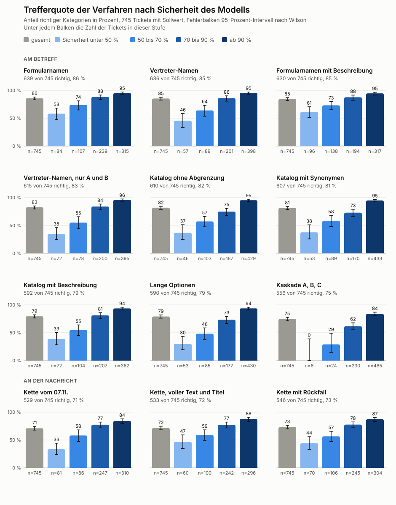

# Einordnung von Tickets

Hier halten wir fest, wie wir Schritt für Schritt zu einer brauchbaren Einordnung von Repair-Café-Tickets gekommen sind. Die Reihenfolge ist Absicht. Jeder Schritt zeigt, was wir ausprobiert haben, was dabei herauskam und warum wir den nächsten Schritt gegangen sind. Die Dokumentation dient als Grundlage für die Fallstudie in [case-study](../case-study/manuel.adoc).

Alle Zahlen stammen vom 06. und 07.11.2026, die Sollwerte aus der Kontrolle durch das Team vom 07.11.2026. Rohdaten zu den erfundenen Tickets und zum öffentlichen Datensatz liegen in [eval/results/decision](../eval/results/decision), die Tabellen stehen in den [Benchmarks](benchmarks.md). Echte Tickets und daraus abgeleitete Ergebnisse liegen nur lokal und gehören nicht in dieses Repo. Hier stehen deshalb nur Summen und allgemeine Gerätebezeichnungen.

## Vorgehen

Die Arbeit folgt demselben Ablauf wie die [Datenpotenzialanalyse](../datenpotenzialanalyse-repairc-cafe-gt/README.md) von 2022, also den Schritten einer Datenanalyse nach Wickham und Grolemund. Neu ist, dass ein Modell einen Teil der Handarbeit übernimmt.

| Schritt | Datenpotenzialanalyse 2022 | MANUEL 2026 |
|---|---|---|
| Import | Laufzettel abgetippt, je Typ eine CSV | Export aus Zammad, erste Nachricht über die API |
| Tidy | Von Hand vereinheitlicht, Rohwert als Kopie behalten | Modell ordnet ein, Rohwert bleibt, Menschen prüfen |
| Transform | Kategorien abgeleitet | Kategorien, Stromversorgung, Defekt |
| Visualise | Tabellen | Tabellen und Grafiken |
| Model | nicht Teil der Arbeit | Decision- und Sprachmodell |
| Communicate | Handlungsempfehlungen | Vorschläge im Ticket, Fallstudie |

Drei Grundsätze übernehmen wir direkt:

- **Rohwert behalten.** Wie `Gerät/Gegenstand-raw` und `Defekt-raw` bleibt der Originaltext neben dem Vorschlag stehen.
- **Feste Wertelisten.** Geräte und Marken kommen aus den Daten von reparatur-initiativen.org, die Defekte aus den 22 selbst bestimmten Werten.
- **Vergleich vor und nach der Bereinigung.** Wie in Tabelle 2 der Arbeit zeigen Anzahl und verschiedene Werte, was die Aufbereitung bringt.

## Überblick

| Schritt | Daten | Verfahren | Wichtigste Erkenntnis |
|---|---|---|---|
| 1 | 83 erfundene Tickets | Decision-Modelle mit 12 Kategorien | `d3:9b` trennt sicherheitsrelevante Fälle fast perfekt |
| 2 | 46 erfundene Tickets | Sechs Fragen pro Ticket | Wunschzeit und Stromversorgung klappen gut, die Absicht nicht |
| 3 | 50 erfundene Tickets | Klarere Beschreibung der Optionen | Die Formulierung der Optionen entscheidet |
| 4 | 83 erfundene Tickets | Sprachmodell übersetzt zuerst | Hilft kleinen Modellen, bringt aber neue Fehler |
| 5 | 746 echte Betreffe | Zwei Stufen mit 386 Kategorien | Eine falsche erste Stufe verdeckt die richtige Antwort |
| 6 | 746 echte Betreffe | Ähnlichkeitssuche plus Decision-Modell, 759 Kategorien | Eine Stufe ist schneller und findet mehr |
| 7 | 204 unsichere Tickets | Sprachmodell entscheidet nach | Keine verlässliche zweite Instanz, Abweichungen zeigen aber Prüffälle |
| 8 | 746 echte Nachrichten | Decision-Modell direkt auf der Nachricht | Lange Texte überfordern es, Betreffe gehen deutlich besser |
| 9 | 746 echte Nachrichten | Sprachmodell zieht Gegenstände heraus, Decision-Modell ordnet ein | Bester Weg für Nachrichten, erkennt auch mehrere Geräte |
| 10 | 279 Laufzettel von 2019 bis 2021 | Vergleich mit den von Hand bereinigten Werten | Erste echte Trefferquote, die Sicherheit des Modells ist aussagekräftig |
| 11 | 746 echte Tickets | Kontrolle durch das Team und eine zweite Prüfung | Am Betreff 83 Prozent richtig, die meisten Fehler liegen an der Liste |
| 12 | 746 echte Betreffe | Aktuelle Liste des Formulars, Entwurf von Zwischenkategorien nach ORA | Mehr Einträge helfen nicht, fast gleiche Namen verwirren das Modell |
| 13 | 746 echte Betreffe | ORA-Gruppe zuerst, dann Kategorie | Gruppe zu 88 Prozent richtig, für die Kategorie kein Gewinn |
| 14 | 746 echte Betreffe | Katalog mit Zusammenfassungen, Synonymen und Beschreibungen, Kaskade nach ABC | Vertreter-Namen fast gleich gut bei weniger Nachfragen, Beschreibungen und Kaskade schaden |
| 15 | 746 echte Nachrichten | Kette mit vollständigem Text und Titel der Notizen | Titel hilft bei Notizen, mit Rückfall 546 statt 529 Treffer |
| 16 | 746 echte Betreffe | Ursachen der sicheren Fehler, Regeln für Rückfragen | Mit zwei Regeln, den Entscheidungen des Teams und der Nachricht 98,7 Prozent richtig oder nachgefragt, 10 sichere Fehler |

## Schritt 1 Erfundene Tickets

Zuerst wollten wir wissen, ob ein Decision-Modell überhaupt mit deutschem Text umgehen kann, denn die Modellkarten nennen kein Deutsch. Dafür haben wir 83 Tickets erfunden, darunter eindeutige Fälle, versteckte Gefahren, harmlose Kontrollen, Fallen, sehr kurze Texte und Versuche, das Modell zu steuern. Die Etiketten haben wir selbst vergeben.

Bei der Frage sicherheitsrelevant zeigte sich ein klares Bild. `d3:9b` übersah bei einer Schwelle von 0,5 nur 2 von 49 Fällen, mit einer Schwelle von 0,34 keinen mehr, bei einem einzigen Fehlalarm. Sprachmodelle waren bei der Kategorie mit bis zu 87 Prozent besser, ließen sich aber nicht über eine Schwelle einstellen.

Daraus folgte die Aufteilung. Sicherheit und feste Auswahlwerte übernimmt ein Decision-Modell, Texte schreibt ein Sprachmodell.

## Schritt 2 Weitere Fragen

Danach haben wir geprüft, was das Modell noch einordnen kann. An 46 weiteren erfundenen Tickets lagen Wunschzeit und Stromversorgung bei `d3:9b` bei 96 Prozent, die Frage nach einer genannten Marke bei 100 Prozent. Die Absicht der Nachricht blieb mit 76 Prozent deutlich zurück. Sechs statt zwei Fragen verdoppelten die Zeit pro Ticket etwa.

## Schritt 3 Klarere Beschreibungen

Der Fehler bei der Absicht lag vor allem an der Grenze zwischen Absage und Verschieben. Eine häufige Nachricht wie „ich melde mich wieder“ fiel oft unter Verschieben. Wir haben nur die Beschreibungen geändert. Eine Absage heißt nun, dass jemand ohne neue Zeit absagt, auch wenn er sich später melden will. Verschieben verlangt eine andere Zeit.

Damit stieg die Trefferquote von 37 auf 46 von 50 Tickets. Die Beschreibungen sind am selben Testsatz geschärft, der Wert ist deshalb eher zu hoch. Die Erkenntnis gilt trotzdem. Bei Decision-Modellen entscheidet die Formulierung der Optionen.

## Schritt 4 Übersetzung

Aus dem Team kam die Idee, das Sprachmodell den Text ins Englische übersetzen zu lassen. Kleine Modelle profitierten deutlich, `tev1:4b` übersah 3 statt 26 Gefahren und `nimble:9b` 2 statt 6. `d3:9b` blieb fast gleich. Die Übersetzung machte aber Fehler. Aus „funkt innen“ wurde „leaking radiation“. Für die Sicherheit ist ein zusätzlicher fehleranfälliger Schritt riskant, wir nutzen ihn deshalb nur als Rückfallebene.

## Schritt 5 Echte Betreffe mit zwei Stufen

Aus den Exporten von Zammad standen 788 Tickets von 2024 bis 2026 bereit, ohne Spalten mit Namen. Davon sind 746 echte Reparaturen, die übrigen sind Einträge für die Statistik. Der Betreff nennt fast immer das Gerät.

Die Kategorien kamen zuerst aus `database.sql` von mapped-repair-events, 386 Einträge in 14 Oberkategorien. Weil die Anleitung nur 26 Optionen nennt, haben wir zwei Stufen gebaut, erst die Oberkategorie, dann die Kategorie darunter. Ein Test zeigte, dass `d3:9b` auch 122 Optionen verarbeitet.

Das Ergebnis lag bei 3,1 Sekunden pro Ticket. 384 Tickets erreichten mindestens 90 Prozent Sicherheit, 114 blieben unter 50 Prozent. Beim Mitlesen fiel eine grundsätzliche Schwäche auf. Ein Ultraschallgerät landete in der ersten Stufe bei Elektro Sonstiges, obwohl der Ultraschallreiniger unter Haushaltsgeräte steht. In der zweiten Stufe stand die richtige Antwort dann gar nicht zur Wahl. Außerdem fehlten Kategorien wie der 3D-Drucker, weil `database.sql` nicht aktuell ist.

## Schritt 6 Ähnlichkeitssuche und eine Stufe

Daraus folgten zwei Änderungen. Die Kategorien kommen nun aus `cf-mf-update-2024-09.csv` mit 759 Einträgen. Die Stufen entfallen. `bge-m3` sucht für jedes Ticket die 25 ähnlichsten Kategorien aus der ganzen Liste, `d3:9b` wählt daraus.

| Messgröße | Schritt 5 | Schritt 6 |
|---|---|---|
| Kategorien zur Auswahl | 386 | 759 |
| Zeit pro Ticket | 3,1 s | 1,0 s |
| Sicherheit unter 50 Prozent | 114 Tickets | 89 Tickets |
| Sicherheit mindestens 90 Prozent | 384 Tickets | 322 Tickets |

Die Beispiele aus Schritt 5 lösten sich damit. Das Ultraschallgerät wurde zum Ultraschallreiniger, die 3D-Drucker fanden ihre Kategorie. Weniger Fälle über 90 Prozent bedeuten hier nicht schlechtere Ergebnisse, denn das Modell wählt nun aus deutlich mehr ähnlichen Optionen. Wie gut es wirklich ist, zeigt erst die Kontrolle durch Menschen.

## Schritt 7 Sprachmodell bei Unsicherheit

Für die 204 Tickets unter 70 Prozent Sicherheit entscheidet `qwen3.6:35b-a3b` noch einmal. Es sieht dieselben 25 Kategorien und darf eine neue Unterkategorie oder `??` vorschlagen. Das entspricht dem Ablauf am Empfang, wo unklare Fälle `??` bekommen und das Formular eine eigene Unterkategorie erlaubt. 
Das Ergebnis fiel anders aus als erhofft. Bei 1,9 Sekunden pro Ticket stimmte das Sprachmodell in 99 von 204 Fällen mit `d3:9b` überein, in 101 Fällen wählte es etwas anderes, 4-mal schlug es eine neue Kategorie vor. `??` nutzte es nie. Einzelne Fälle wurden besser, aus Stehleuchte wurde die wörtlich passende Stehlampe. Andere wurden deutlich schlechter, ein Radio landete bei Saftpresse, ein Drucker bei Laserdrucker. Offenbar neigt das Sprachmodell unter der festen Liste dazu, etwas Spezielleres oder Falsches zu wählen, statt die naheliegende Kategorie zu nehmen.

Das Sprachmodell ist damit keine zuverlässige zweite Instanz. Nützlich ist die Abweichung trotzdem, denn sie zeigt, welche Tickets ein Mensch ansehen sollte. Ob es nachentscheiden darf, klären erst die Sollwerte.

## Schritt 8 Decision-Modell auf der Nachricht

Beim Eingang liegt nur die Nachricht vor, nicht der von Engagierten geschriebene Betreff. Wir haben deshalb die erste Nachricht jedes Tickets über die Schnittstelle von Zammad nur lesend geholt und nach Herkunft getrennt.

| Herkunft | Tickets | Sicherheit im Median | Unter 50 Prozent |
|---|---|---|---|
| Webformular | 128 | 86 % | 9 |
| Freie Nachricht | 308 | 65 % | 103 |
| Voicemail | 238 | 80 % | 42 |
| Empfang | 72 | 86 % | 10 |

Beim Empfang stehen oft Pflichttexte wie „kam spontan vorbei“ im Ticket. Diese ersetzt das Skript durch Betreff und Defekt. Das Formular trennt Gegenstand und Defekt und liefert darum ähnlich gute Werte wie der Betreff. Freie Nachrichten sind schwächer, denn das Modell soll hier aus einem langen Text gleichzeitig Gerät, Fehler und Kategorie herauslesen. Die Fragen, ob Gegenstand und Defekt erkennbar sind, schlugen zudem oft falsch an.

## Schritt 9 Erst herausziehen, dann einordnen

Daraus folgte die Trennung der Aufgaben. `qwen3.6:35b-a3b` zieht pro Gegenstand Name, Marke und Defekt aus dem Text. Es soll nichts erfinden und gibt bei Unklarheit eine leere Liste aus. Danach läuft für jeden Gegenstand die Ähnlichkeitssuche und `d3:9b` wählt die Kategorie.

Der erste Lauf scheiterte an einem Fehler im Skript, 624 von 746 Tickets brachen ab. Die übrigen 122 Tickets gaben trotzdem einen Hinweis. Das Sprachmodell lieferte dort zu Recht nichts, denn es waren kurze Notizen wie „klemmt“ oder „runtergefallen“. Das Gerät steht bei solchen Tickets nur im Betreff, den Engagierte beim Anruf gesetzt haben. Deshalb gibt es nun einen Rückfall. Findet das Sprachmodell nichts, nimmt das Skript bei Anrufen den Betreff des Tickets und bei Antwortmails den Betreff der Mail. So wurden 100 Tickets eingeordnet, 22 blieben ohne Gegenstand, 19 davon Voicemails. Sie bekommen `??`.

Sollwerte fehlen hier noch. Als Hilfsmaßstab dienen die 322 Tickets, bei denen `d3:9b` den Betreff in Schritt 6 mit mindestens 90 Prozent Sicherheit eingeordnet hat. Das misst Übereinstimmung mit einem Modellwert und keine Richtigkeit.

| Vergleich mit dem Betreff, 322 Tickets | Decision-Modell allein | Kette | Kette ohne Rückfall |
|---|---|---|---|
| Gleiche Kategorie | 226 (70 %) | 257 (80 %) | 217 (67 %) |
| Gleiche Oberkategorie | 253 (79 %) | 292 (91 %) | nicht gezählt |
| Zeit pro Ticket, Median | 4,0 s | 4,4 s | 4,4 s |

Ein Teil des Gewinns ist nicht fair, denn der Rückfall nutzt genau den Betreff, mit dem wir vergleichen. Ohne Rückfall liegt die Kette knapp hinter dem Decision-Modell allein, sie lässt dort aber 52 Tickets offen, statt zu raten. Auf ihre eigene Sicherheit ist mehr Verlass. Liegt sie bei mindestens 90 Prozent, stimmen 223 von 245 Kategorien mit dem Betreff überein. Das Decision-Modell allein erreicht bei gleicher Schwelle 172 von 182, nimmt aber deutlich weniger Tickets mit.

Nebenbei löst die Kette die Frage nach mehreren Geräten. Gäste melden manchmal zwei Geräte in einer Nachricht an, das Team teilt das dann auf mehrere Tickets auf. Bei 21 Nachrichten ist das im Bestand passiert, die Kette hat davon 17 erkannt. Insgesamt nannte sie bei 95 Tickets mehr als einen Gegenstand, die Stichprobe zeigt überwiegend echte Fälle. Zwei eigene Fragen an das Decision-Modell nach Gegenstand und mehreren Geräten entfallen damit.

Schwach bleiben Marke und fehlender Defekt. Von 182 hinterlegten Marken fand das Sprachmodell 112. Bei den 70 Tickets, die im Export `??` als Defekt tragen, ließ es den Defekt nur 30-mal leer. Möglicherweise steht in der Nachricht durchaus etwas, das nie ins Ticket übertragen wurde. Das klären die Sollwerte. Die Stromversorgung stimmt bei 32 von 43 Tickets. Das ist nicht besser als beim Betreff.

## Schritt 10 Vergleich mit der Datenpotenzialanalyse

Für eine echte Trefferquote braucht es Sollwerte. Die gibt es bereits. In der Datenpotenzialanalyse wurden die Laufzettel von 2019 bis 2021 von Hand bereinigt, der Datensatz ist öffentlich und enthält keine Personendaten. Das Modell bekam die Rohwerte und musste die bereinigten Werte treffen, 279 Zeilen in 2,6 Sekunden pro Zeile.

| Größe | Treffer | Quote |
|---|---|---|
| Oberkategorie | 227 von 268 | 85 % |
| Stromversorgung | 187 von 231 | 81 % |
| Gerät exakt | 188 von 273 | 69 % |
| Defekt aus 22 Werten | 174 von 272 | 64 % |

Exakte Gleichheit ist ein strenger Maßstab. Die Werte von 2021 stammen aus einer anderen Fassung der Liste. Viele Abweichungen sind nur andere Namen, Handmixer und Handrührgerät zum Beispiel. Das Team hat Paare wie dieses in [gleichwertig.tsv](../eval/decision/gleichwertig.tsv) bestätigt. Rechnet man sie ein und zählt die beiden Waagen mit Batterie als richtig, sind es 196 von 273 oder 72 Prozent. Die Paare sind erst nach dem Ergebnis ausgesucht, die Zahl ist also eine obere Schätzung. Nicht jede ähnliche Bezeichnung ist gleichwertig. Personenwaage steht für die Waage ohne Elektrik, `Waage, elektrisch` für die mit Strom. Bei der Stromversorgung verwechselt das Modell vor allem `mit Netzteil` und `230 V` (10 Fälle) sowie Batterie und Akku (8 Fälle). Das Team will `mit Netzteil` als eigenen Wert behalten, denn eine LED-Leuchte mit Netzteil arbeitet anders als eine Nachttischlampe mit E27-Fassung. Wir haben deshalb die Beschreibungen geschärft. Das ging schief, die Treffer fielen von 187 auf 131. `mit Netzteil` stieg nur von 3 auf 7 von 18, dafür wanderten 39 von 160 Geräten mit `230 V` zu `mit Netzteil`, DVD-Player und Verstärker etwa. Wir bleiben daher bei den alten Beschreibungen. Anders als in Schritt 3 half die Schärfung nicht. Ob ein Gerät ein Netzteil hat, steht selten im Text, das gehört zur Prüfung durch Menschen. Beim Defekt liegt es oft nah daneben, Kabelbruch gegen defekten Stecker etwa.

Daran haben wir drei Fragen geklärt.

**Sagt die Sicherheit etwas aus?** Ja. Mit der Sicherheit steigt die Trefferquote. Die Werte stammen aus dem Lauf mit der Gerätebezeichnung:

| Sicherheit | Zeilen | Gerät exakt |
|---|---|---|
| unter 50 % | 50 | 46 % |
| 50 bis 70 % | 55 | 58 % |
| 70 bis 90 % | 69 | 80 % |
| ab 90 % | 99 | 81 % |

Oberhalb von 70 Prozent lohnt keine feinere Abstufung. Das ergibt eine einfache Regel. Darunter gehört das Ticket auf den Prüfstapel.

**Hilft es, die Ähnlichkeit nur mit dem Gerät zu suchen?** Kaum, 190 statt 188 Treffer. Die Annahme, der Defekttext verschlechtere die Suche, bestätigte sich nicht. Auffällig ist etwas anderes. `bge-m3` allein setzt die richtige Kategorie schon 177-mal auf Platz 1, in den ersten fünf liegt sie 222-mal, also bei 81 Prozent. In der Vorauswahl von 25 fehlt sie 36-mal. Für das Ticket bietet es sich also an, drei bis fünf Vorschläge anzuzeigen statt nur einen.

**Darf das Sprachmodell nachentscheiden?** Nein. Bei den 104 Zeilen unter 70 Prozent Sicherheit lag `d3:9b` 55-mal richtig, `qwen3.6:35b-a3b` 48-mal. Nur das Sprachmodell lag 8-mal richtig, nur das Decision-Modell 15-mal. Das Nachentscheiden senkt das Gesamtergebnis von 190 auf 183. Das bestätigt den Eindruck aus Schritt 7 nun mit Sollwerten.

## Schritt 11 Sollwerte aus der Kontrolle

Das Team hat alle 746 Vorschläge aus Schritt 6 in einer Tabelle geprüft und dabei auch die Nachrichten der Gäste gelesen. Unabhängig davon hat Claude dieselben Zeilen geprüft, allerdings nur mit Betreff, Defekt und Vorschlag. Beide Prüfungen hatten keinen Einblick in die jeweils andere.

| Ergebnis am Betreff | Treffer | Quote |
|---|---|---|
| Oberkategorie | 718 von 746 | 96 % |
| Kategorie | 619 von 746 | 83 % |
| Kategorie, nur Sollwerte aus der Liste | 619 von 690 | 90 % |
| Stromversorgung | 643 von 742 | 87 % |

Die Sicherheit des Modells trennt wie in Schritt 10 gut zwischen sicheren und unsicheren Fällen.

| Sicherheit | Tickets | Kategorie richtig |
|---|---|---|
| unter 50 % | 89 | 48 % |
| 50 bis 70 % | 115 | 71 % |
| 70 bis 90 % | 219 | 84 % |
| ab 90 % | 323 | 96 % |

Die 127 Fehler fallen in drei Gruppen.

- **Die Liste ist veraltet.** 55 Sollwerte stehen nicht in `cf-mf-update-2024-09.csv`, aber im Formular auf reparatur-initiativen.org, zum Beispiel `Fahrrad, allgemein`, `Hörbox` oder `Akkustaubsauger`. Diese Fälle kann das Modell gar nicht treffen.
- **Der Betreff sagt zu wenig.** Bei 17 Tickets mit dem Betreff Kaffeemaschine ergibt erst die Nachricht, ob es ein Vollautomat oder eine Kapselmaschine ist.
- **Das Wort täuscht.** Rund 20 Fälle landen bei einem ähnlich klingenden, aber fremden Gerät. Aus dem Barttrimmer wird ein Rasentrimmer, aus dem Mixer ein Mischpult, aus der Schwebetrockenhaube eine Dunstabzugshaube.

Die Oberkategorie ist dagegen fast immer richtig. Sie hilft dem Modell aber wenig, weil `Elektro divers` und `Haushaltsgeräte` sehr verschiedene Geräte bündeln.

Das Sprachmodell aus Schritt 7 lag bei den 204 unsicheren Tickets 94-mal richtig, `d3:9b` 125-mal. Die Kette aus Schritt 9 trifft allein mit der Nachricht 510 von 746 Kategorien, ab 90 Prozent Sicherheit 257 von 311. Sie bleibt damit hinter dem Betreff zurück. Für neue Tickets ist sie trotzdem der Weg, denn beim Eingang gibt es noch keinen Betreff.

Die beiden Prüfungen stimmen bei 84 Prozent der Kategorien überein. Die meisten Abweichungen erklären sich daraus, dass das Team die Nachrichten und die aktuelle Liste des Formulars kannte. Für die Bewertung gelten deshalb die Werte des Teams. Die zweite Prüfung zeigt aber, dass auch Menschen bei der Kategorie nicht immer gleich urteilen. Eine Quote von 100 Prozent ist also kein realistisches Ziel.

## Schritt 12 Aktuelle Liste des Formulars

Die Kategorien stammen jetzt direkt aus dem Laufzettel auf reparatur-initiativen.org. Das sind 1.186 bestätigte Einträge statt 759 in der CSV. Unbestätigte Vorschläge anderer Initiativen bleiben draußen. Der Ablauf ist sonst derselbe wie in Schritt 6.

Für einen fairen Vergleich zählen beide Läufe gleich. Gleichwertige Paare, Teilnamen mit Schrägstrich wie `Laptop / Notebook` und Zusätze in Klammern wie bei `Receiver (Sat, Kabel, Antenne, Audio)` gelten als Treffer. Von 746 Tickets haben 745 einen Sollwert.

| Liste | Kategorie richtig |
|---|---|
| CSV aus Schritt 6 | 628 von 745 |
| Formular | 624 von 745 |
| CSV mit allen Paaren vom 07.11. | 633 von 745 |
| Formular mit allen Paaren vom 07.11. | 634 von 745 |

Die längere Liste allein bringt also nichts. Sie behebt zwar die veralteten Namen aus Schritt 11, in 31 Fällen trifft das Modell jetzt den Sollwert und lag vorher daneben. In 35 Fällen ist es aber umgekehrt. Die neue Liste enthält viele fast gleiche Einträge, zwischen denen das Modell schwankt, zum Beispiel `Schwibbogen` und `Lichterbogen`, `Türgong` und `Funkglocke /Funkklingel`, `Handy` und `Mobiltelefon`, `Standmixer` und `Mixer` oder `Quadrocopter` und `Drohne`. Dazu kommt, dass die Sollwerte mit der alten Liste vor Augen entstanden sind. Das begünstigt die CSV etwas.

Das Team hat daraufhin weitere Paare festgelegt. `Mixer` allein wird nicht vergeben, weil Standmixer und Handmixer verschiedene Geräte sind. Sauger mit Akku zählen als `Staubsauger` mit Strom Akku, nur `Handstaubsauger` bleibt eigen. Bei Audiogeräten zählt die Ausstattung, nicht die Größe. Mit CD, Kassette oder Plattenspieler in einem Gerät ist es eine `Musikanlage`, auch der tragbare Radiorekorder, den der Standard als Boombox zu Hi-Fi integrated zählt. Vorverstärker und Surround-Anlage gehören zum `Verstärker`, Geräte nur mit Empfang zum `Radio`. Das `Röhren-Radio` bleibt eigen. Mit allen Paaren liegt die Formularliste knapp vor der CSV.

Die Sicherheit bleibt aussagekräftig.

| Sicherheit | Tickets | Kategorie richtig |
|---|---|---|
| unter 50 % | 84 | 54 % |
| 50 bis 70 % | 107 | 71 % |
| 70 bis 90 % | 239 | 87 % |
| ab 90 % | 315 | 94 % |

### Entwurf der Zwischenkategorien

Die Oberkategorien des Formulars sind zu grob, `Elektro divers` reicht vom Lötkolben bis zur Lichterkette. Maßgeblich für die Zwischenstufe sind deshalb die Produktkategorien des Open Repair Data Standard. Das sind 40 Gruppen mit Strom und 6 ohne Strom ([ora-gruppen.tsv](../eval/decision/ora-gruppen.tsv)). Jede Gruppe hat eine deutsche Beschreibung aus den Beispielen des Standards.

[groups.py](../eval/decision/groups.py) lässt `d3:9b` jede Formularkategorie einer Gruppe zuordnen. Die Hälfte der Zuordnungen liegt unter 70 Prozent Sicherheit, 324 unter 50 Prozent. Das liegt oft an der Liste selbst. Unter `Haushaltsgeräte` stehen auch Kugelschreiber, Gießkanne und Kinderwagen, die keine Gruppe mit Strom treffen. Claude hat 17 klare Fehler korrigiert, etwa die Personenwaage nach Entscheidung des Teams oder den Kleiderbügel, der als zweite Wahl beim Bügeleisen lag.

Wo eine ORA-Gruppe zu grob ist, steht darunter eine eigene Zwischenkategorie. `Misc` zerfällt zum Beispiel in Elektroinstallation, Mess- und Prüfgeräte, Pumpen und Wasser, Heizen und Wärme, Medizin und Pflege sowie Motoren und Antriebe. `Power tool` trennt Gartengeräte und Löten vom übrigen Elektrowerkzeug. Die Zwischenkategorien sind feiner als der Standard, lassen sich aber immer auf ihn zurückführen. Den Entwurf prüft das Team noch.

### Katalog mit Beschreibungen

Weil die Fehler vor allem zwischen ähnlichen Einträgen entstehen, bekommt jeder Gegenstand eine kurze Beschreibung mit Abgrenzung zu den Nachbarn und Synonyme, jeweils auf Deutsch und Englisch ([katalog](../katalog/)). Mit dem englischen Teil lassen sich auch die Daten anderer Initiativen zuordnen. Die anstiftung liefert nur 56.118 der rund 620.000 Einträge in den Open Repair Data.

Zuerst sollte `qwen3.6:35b-a3b` die Entwürfe schreiben. Nach sieben Einträgen war klar, dass das nicht trägt. Es erfand Synonyme, um auf die verlangte Zahl zu kommen, etwa Staubfänger für den Staubsauger oder narrowing machine für die Nähmaschine, und gab beim Staubsauger ein Netzteil an. Die Entwürfe stammen deshalb von Claude, das Team prüft sie.

Beim Schreiben zeigte sich ein zweites Problem. Viele naheliegende Synonyme sind im Formular eigene Einträge, zum Beispiel Wanduhr neben Uhr oder Bartschneider neben Haarschneidemaschine. Eine Prüfung verhindert jetzt, dass ein Wort zu zwei Einträgen gehört. Solche Fälle gehen als Frage an das Team.

### Prüfung der Zusammenfassungen

Welche Einträge gleich gelten, entscheidet das Team. Die Vorschläge dazu stammten zunächst nur aus dem Namen. Nachträglich wurden sie auf zwei Wegen geprüft, mit einer Recherche im Internet und mit den Marken, die in den Open Repair Data für jeden Eintrag stehen. Haben zwei Einträge dieselben Marken, ist meist dasselbe gemeint.

Dabei fielen fünf Fehler auf, zwei davon hatte das Team schon bestätigt.

| Paar | Befund |
|---|---|
| E-Ladegerät und Ladegerät E-Bike | Marken wie Makita, TomTom und Clatronic, also ein allgemeines Elektro-Ladegerät |
| Projektor und Beamer | Marken wie Noris und VEB Kamera- und Kinowerke Dresden, also meist alte Dia- und Filmprojektoren |
| Display und Monitor | steht unter Smartphone/Tablet, Marken gemischt bis zum E-Bike-Display |
| Kette und Halskette | steht unter Metallbearbeitung |
| Astschere und Gartenschere, E-Piano und Synthesizer zum Keyboard | laut Recherche verschiedene Geräte |

Umgekehrt zeigte die Prüfung ein neues Paar. Der `Zauberstab` unter `Elektro divers` ist fast immer ein Stabmixer von ESGE, mit Messer, Raspler und Kohlebürsten. Die anstiftung meldet ihn trotzdem als Spielzeug.

### Schwere der Fehler

Für die Reparaturvorschläge wiegt nicht jeder Fehler gleich. Bleibt er in derselben ORA-Gruppe, passen die Vorschläge meist trotzdem. Landet er in einer anderen Gruppe, führen sie in die falsche Richtung. Mit allen Paaren aus Schritt 12 verteilen sich die 107 Fehler am Betreff so.

| Fehler | Tickets | davon ab 70 % Sicherheit |
|---|---|---|
| gleiche ORA-Gruppe | 58 | 25 |
| andere ORA-Gruppe | 49 | 20 |

Die 20 sicheren Fehler in einer anderen Gruppe sind die gefährlichen, denn MANUEL würde dort nicht nachfragen. Beispiele sind der Stabmixer als Zauberstab, das Akku-Ladegerät als CD-Player und der Dampfbügler als Glätteisen.

Zwei naheliegende Gegenmittel helfen kaum. Die ORA-Gruppe aus Schritt 13 als zweite Kontrolle fängt nur drei dieser Fehler ab und schickt dafür 19 richtige Einordnungen zur Nachfrage. Bei mehrdeutigen Betreffen irrt die Gruppe genauso. Ein Nachschlagen bereits bestätigter Betreffe greift bei 382 von 745 Tickets und bringt insgesamt 641 statt 638 Treffer. Wiederholte Betreffe trifft das Modell ohnehin meist. Das Nachschlagen sorgt aber für einheitliche Einordnungen und spart Rechenzeit.

## Schritt 13 Gruppe vor der Kategorie

[real_group.py](../eval/decision/real_group.py) fragt `d3:9b` zuerst nach der ORA-Gruppe. Die Shortlist besteht dann aus den 20 ähnlichsten Kategorien der beiden wahrscheinlichsten Gruppen und den 10 ähnlichsten ohne Einschränkung. Grundlage ist der noch ungeprüfte Entwurf aus Schritt 12. Ein Ticket dauert im Median 3,7 Sekunden.

| Verfahren | Kategorie richtig |
|---|---|
| CSV ohne Gruppe | 628 von 745 |
| Formular ohne Gruppe | 624 von 745 |
| Formular mit Gruppe | 617 von 745 |
| beides mit allen Paaren vom 07.11. | 634 und 629 von 745 |

Die Gruppe bringt für die Kategorie nichts. Dabei trifft sie selbst gut. Bei 730 Tickets lässt sich der Sollwert einer Gruppe zuordnen. Die erste Wahl stimmt 642-mal, unter den ersten zwei Gruppen liegt die richtige 683-mal. Ab 70 Prozent Sicherheit stimmt eine der beiden in 585 von 595 Fällen.

Der Engpass liegt also nicht zwischen den Gruppen, sondern innerhalb. Die meisten Fehler sind dieselben fast gleichen Namen wie in Schritt 12, dazu kommen neue wie `Radio` gegen `Transistorradio` oder `Handstaubsauger` gegen `Akkustaubsauger`. Weiter hilft deshalb eine bereinigte Liste mit weniger Dopplungen, nicht eine weitere Stufe davor.

Für die Meldung an die Open Repair Alliance ist die Gruppe trotzdem nützlich. Sie lässt sich mit 88 Prozent direkt bestimmen und bei Unsicherheit mit zwei Vorschlägen nachfragen.

### ABC-Analyse der Einträge

Die Liste des Formulars ist über die Jahre gewachsen, weil jede Initiative eigene Kategorien vorschlagen kann. Eine ABC-Analyse der 1.084 zusammengefassten Einträge nach ihrer Häufigkeit in den deutschen Open Repair Data zeigt, wie ungleich sie genutzt werden. A reicht bis 80 Prozent der Reparaturen, B bis 95 Prozent.

| Klasse | Einträge | Reparaturen in DEU | Tickets in Gütersloh |
|---|---|---|---|
| A | 113 (10 %) | 44.986 (80 %) | 552 |
| B | 249 (23 %) | 8.372 (15 %) | 144 |
| C | 722 (67 %) | 2.795 (5 %) | 49 |

Zwei Drittel der Einträge decken nur 5 Prozent der Reparaturen und 49 der 745 Tickets ab. Die Klassen beruhen auf bundesweiten Daten und nicht auf den eigenen Tickets, die Verteilung in Gütersloh passt trotzdem gut. Der Katalog deckt alle A-Einträge und knapp die Hälfte der B-Einträge ab.

## Schritt 14 Katalog in der Einordnung

[real_catalog.py](../eval/decision/real_catalog.py) ordnet die Betreffe mit dem Katalog ein. Die Ähnlichkeitssuche nutzt Name und Synonyme, das Decision-Modell sieht zu jeder Option einen Text. Grundlage sind 1.084 Einträge nach allen Zusammenfassungen, 225 davon mit Beschreibung.

Im ersten Versuch bekam `d3:9b` die Beschreibung aus dem Katalog. Das Ergebnis war deutlich schlechter, 592 statt 639 Treffer. Zwei Ursachen fallen auf.

- **Die Beschreibung ersetzt den Namen.** Beim Betreff Toaster wählte das Modell `Küchengerät`, das ohne Beschreibung nur mit seinem Namen dastand. Die Beschreibung des Toasters nennt das Wort Toaster nicht.
- **Die Abgrenzung lockt zum Nachbarn.** Sätze wie „Die kleine Handnähmaschine ist ein eigener Eintrag“ führten dazu, dass vier Nähmaschinen bei der Handnähmaschine landeten, Radiowecker beim Wecker und Akkustaubsauger beim Handstaubsauger.

Was Menschen hilft, kann das Modell also in die Irre führen. Für das Modell braucht der Katalog deshalb einen eigenen Text.

Im zweiten Versuch sah das Modell nur Name und Synonyme. Das ergab 607 Treffer, immer noch weniger als ohne Katalog. Jetzt zeigte sich ein drittes Problem. Zusammengefasste Einträge verlieren für das Modell ihren Namen. Beim Betreff Radiowecker hieß die passende Option nur noch `Radio`, und das Modell wählte `Wecker`. Thermomix landete bei `Küchengerät` statt bei `Küchenmaschine`, Heizlüfter bei `Standlüfter` statt bei `Elektroheizung`. Auch die Oberkategorie fehlte als Kontext.

Der Katalog gehört deshalb hinter das Modell. Das Modell wählt weiter aus den Namen des Formulars mit Oberkategorie, die Zusammenfassung zu einem Katalogeintrag folgt danach.

Ein dritter Versuch fasste die Einträge zusammen und ließ die Namen in der Option sichtbar, etwa `Unterhaltungselektronik / Radio (auch Radiowecker, DAB-Radio, Kofferradio, …)`. Das ergab nur 590 Treffer. Lange Optionen verlieren. Beim Betreff Radio wählte das Modell `Funkempfänger`, beim Betreff Radiowecker `Wecker (auch Reisewecker, Funkwecker)`. Das Modell bewertet die Option als Ganzes, und eine lange Liste verwässert den Treffer.

Daraus folgt der vierte Versuch mit [real_representatives.py](../eval/decision/real_representatives.py). Die Ähnlichkeitssuche läuft über alle Formularnamen und Synonyme. In der Shortlist erscheint jeder Eintrag nur einmal, und zwar unter dem kurzen Namen, der dem Ticket am ähnlichsten ist. Beim Betreff Radiowecker heißt die Option für den Eintrag Radio also `Unterhaltungselektronik / Radiowecker`. So gibt es weder Fast-Dubletten noch lange Optionen.

Das ergab 636 Treffer, also fast so viele wie ohne Katalog. Neu richtig sind Fälle, in denen ein kurzer Name aus dem Katalog hilft, etwa Airfryer, Fahrradakku, Kassettendeck oder Rasierer. Neu falsch sind vor allem Fälle mit einem ungeschickten Synonym. „Drucker“ landete über das Synonym Druckreiniger beim Hochdruckreiniger, „Laptop“ über Laptopnetzteil beim Netzteil. Diese Synonyme sind entfernt. Die schweren Fehler in einer anderen ORA-Gruppe sinken von 47 auf 42. Das Modell ist häufiger sicher, ab 70 Prozent sind es 599 statt 554 Tickets, und davon stimmen wie bisher 92 Prozent. Zwischen 70 und 90 Prozent liegt die Quote bei 86 statt 88 Prozent, ab 90 Prozent wie bisher bei 95 Prozent. Bei gleicher Trefferquote muss also bei 45 Tickets weniger ein Mensch nachgefragt werden.

### Kaskade nach ABC-Klassen

Ein naheliegender Gedanke ist eine Kaskade. Das Modell wählt erst aus den häufigen A-Einträgen. Ist es unter 70 Prozent sicher, folgt eine Runde mit B, danach mit C. Die Sieger der Runden treten in einer Endrunde gegeneinander an, weil Sicherheiten aus Runden mit verschiedenen Optionen nicht vergleichbar sind. Die Kaskade nutzt dieselben Vertreter-Namen wie der vierte Versuch.

Das ergab nur 556 Treffer. In 594 von 746 Fällen war das Modell schon in der A-Runde sicher, auch dann, wenn das richtige Gerät gar nicht unter den A-Einträgen stand. Die Sicherheit sagt nur, welche der angebotenen Optionen am besten passt, nicht ob überhaupt eine passt. Fehlt die richtige Option, wählt das Modell selbstbewusst die nächstbeste. Die Endrunde war dabei besser als die Regel, die höchste Sicherheit gewinnen zu lassen, mit 556 gegen 542 Treffer. Ein Median von 1,1 Sekunden je Ticket zeigt, dass die meisten Tickets mit einer Runde auskamen.

Eine Kaskade bräuchte eine Option „nichts davon passt“, damit das Modell die nächste Runde selbst anstoßen kann.

Auch eine feste Beschränkung auf A und B, also 362 Einträge, lohnt sich nicht. Sie ergab 615 Treffer bei einer Obergrenze von 696. Ab 70 Prozent Sicherheit stimmten 547 von 595 Fällen, fast genauso wie mit allen Einträgen. Die Vertreter-Namen räumen die Fast-Dubletten schon so weit auf, dass die seltenen Einträge kaum noch stören.

| Verfahren | Treffer von 745 | ab 70 % sicher | davon richtig | schwere Fehler sicher |
|---|---|---|---|---|
| Formularnamen, alle Paare | 639 | 554 | 511 | 18 |
| Katalog mit Beschreibung | 592 | | | 27 |
| Katalog mit Synonymen | 607 | | | 26 |
| Katalog mit Beschreibung ohne Abgrenzung | 610 | | | 27 |
| Formularnamen mit Beschreibung ohne Abgrenzung | 630 | 511 | 470 | 18 |
| zusammengefasst mit langen Optionen | 590 | | | 31 |
| Vertreter-Namen, alle Einträge | 636 | 599 | 553 | 16 |
| Vertreter-Namen, Kaskade A, B, C | 556 | 715 | 549 | 58 |
| Vertreter-Namen, nur A und B | 615 | 595 | 547 | 14 |

Schwere Fehler sicher heißt ab 70 Prozent Sicherheit in einer anderen ORA-Gruppe.

Die Beschreibungen helfen dem Modell in keiner Form. Selbst neben den gewohnten Formularnamen kosten sie Treffer und machen das Modell unsicherer. Der Gewinn des Katalogs für die Einordnung liegt in den Zusammenfassungen und Synonymen, also in den Vertreter-Namen. Die Beschreibungen bleiben für Menschen und für die Nachfrage, bei der Engagierte zwischen nummerierten Vorschlägen wählen.

## Schritt 15 Kette mit vollständigen Nachrichten

[messages.py](../eval/decision/messages.py) holt die Nachrichten jetzt ohne Pseudonymisierung und ohne Kürzung. Zitate früherer Mails bleiben erhalten. Bei Tickets, die Engagierte selbst anlegen, ist der Betreff der Notiz leer. Das Gerät steht dann nur im Titel des Tickets. Die Kette bekommt deshalb bei solchen Notizen den Titel vor den Text gestellt. Das betrifft 126 der 745 Tickets mit Sollwert.

Damit der Vergleich fair bleibt, ist auch der Lauf aus Schritt 9 mit der Zählweise aus Schritt 12 neu ausgewertet. Er kommt so auf 529 statt 510 Treffer. Zwei Tickets gibt es in Zammad nicht mehr, sie zählen als Fehler.

| Lauf | Treffer von 745 | ab 90 % sicher | davon richtig |
|---|---|---|---|
| Kette aus Schritt 9 | 529 | 310 | 261 |
| Kette mit vollständigem Text und Titel | 533 | 296 | 259 |
| dazu Rückfall auf Betreff oder Titel | 546 | 304 | 265 |

Bei den Notizen mit Titel sind 12 Tickets neu richtig und 8 neu falsch. Bei den übrigen Nachrichten halten sich Gewinne und Verluste fast die Waage. Ein Teil der Unterschiede ist also Streuung des Sprachmodells und keine Wirkung des Textes. Der vollständige Text schadet nicht, obwohl er länger ist. Der Rückfall bringt 13 weitere Treffer, vor allem bei kurzen Notizen wie „klemmt“.

Die Kette bleibt mit 546 Treffern hinter dem Betreff mit 639 zurück. Am schwächsten sind die Voicemails mit 160 von 238 Treffern, auf sie entfallen 78 der 199 Fehler. Für neue Tickets ohne Betreff ist sie weiterhin der Weg.

### Alle Verfahren im Vergleich

Die Grafik zeigt für jedes Verfahren die Trefferquote insgesamt und getrennt nach der Sicherheit des Modells. Die Fehlerbalken geben das 95-Prozent-Intervall nach Wilson an. Unter jedem Balken steht, wie viele Tickets in die Stufe fallen. Erzeugt wird sie mit [chart_classification.py](../eval/decision/chart_classification.py).

Bei fast allen Verfahren am Betreff stimmen ab 90 Prozent Sicherheit rund 95 Prozent der Kategorien. Die Verfahren unterscheiden sich vor allem darin, wie viele Tickets diese Stufe erreichen. Die Vertreter-Namen bringen 398 Tickets dorthin, die Formularnamen 315. Die Kaskade fällt aus dem Muster, ihre sicheren Tickets stimmen nur zu 84 Prozent. Unter 50 Prozent sind die Intervalle breit, weil dort nur wenige Tickets liegen.

## Schritt 16 Rückfrage statt Fehler

Das Ziel ist eine Quote nahe 100 Prozent, wobei eine Rückfrage als Erfolg zählt. Entscheidend ist also, wie oft MANUEL sicher ist und trotzdem falsch liegt. Bei den Vertreter-Namen sind das ab 70 Prozent Sicherheit 46 von 599 Tickets. Eine höhere Schwelle allein hilft wenig. Ab 98 Prozent bleiben 3 Fehler, aber 588 von 745 Tickets gehen in die Rückfrage.

Die 46 Fehler wurden von Hand nach Ursachen geordnet.

| Ursache | Fehler | Beispiele |
|---|---|---|
| Sammelbegriff, die Bauart steht erst in der Nachricht | 15 | Kaffeemaschine statt Kapselmaschine oder Vollautomat (11-mal), Mixer, Ladegerät, Lautsprecher |
| Offene Entscheidung oder strittiger Sollwert | 15 | Zwitscherbox oder Geräuschmodul (3-mal), Sternenprojektor, Schlagschrauber, Herrnhuter Stern, elektrische Kerze |
| Dienstleistung oder Bauteil statt Gerät | 7 | Linux-Installation (Soll Festplatte), 3D-Druck (Soll Gehäuse) |
| Echte Verwechslung oder fehlende Angabe im Betreff | 9 | Smartphone beim Display, Handy Wasserschaden beim Wassermelder, Fensterwischer beim Scheibenwischer |

Daraus ergeben sich drei Regeln, die zusätzlich zur Schwelle eine Rückfrage auslösen.

- **R1 Sammelbegriff.** Die Wahl ist ein Eintrag, bei dem das Team ohnehin nachfragen will, etwa Kaffeemaschine, Mixer, Ladegerät, Lautsprecher, Kopfhörer, Fotoapparat oder Projektor.
- **R2 Bauteil oder Dienstleistung.** Die Wahl ist ein Bauteil wie Software, Display, Akku, Kabel oder Netzteil, oder der Betreff nennt eine Installation oder einen 3D-Druck.
- **R3 Kette weicht ab.** Die Kette findet in der Nachricht ein anderes Gerät als im Betreff oder mehrere Geräte.

| Regeln | automatisch | davon falsch | Rückfragen | ohne Fehler |
|---|---|---|---|---|
| nur Schwelle 70 % | 599 | 46 | 146 | 93,8 % |
| Schwelle 70 %, R1 | 568 | 31 | 177 | 95,8 % |
| Schwelle 70 %, R1 und R2 | 557 | 23 | 188 | 96,9 % |
| Schwelle 70 %, R1 bis R3 | 438 | 16 | 307 | 97,9 % |
| nur Schwelle 90 % | 398 | 18 | 347 | 97,6 % |
| Schwelle 90 %, R1 bis R3 | 303 | 9 | 442 | 98,8 % |

Ohne Fehler heißt richtig eingeordnet oder nachgefragt. R1 und R2 lohnen sich. Sie halbieren die sicheren Fehler und kosten nur 42 Rückfragen mehr. R3 ist zu teuer. Die Regel fängt 16 Fehler, schickt aber auch 113 richtige Tickets in die Rückfrage. Die Kette ist dafür noch zu unzuverlässig.

Von den 23 Fehlern nach R1 und R2 waren die meisten offene Entscheidungen oder strittige Sollwerte. Das Team hat sie am 08.11.2026 entschieden. Bei 9 Tickets war der Sollwert zu korrigieren, etwa Zwitscherbox, Space-Projektor, Schlagschrauber und Videokamera, die eigene Einträge sind. Für Herrnhuter Stern, Fensterwischer und Haustelefon kamen Synonyme in den Katalog. Projektor und Lautsprecher lösen künftig eine Rückfrage aus. Nach einer Recherche in den Open Repair Data folgten weitere Entscheidungen. Die Heizung wird nach Lüfter getrennt, Elektrogrill fasst E-Grill, Tischgrill und Partygrill zusammen, Drohne den Quadrocopter. Tischrechner bleiben eigen, weil es meist druckende Rechner mit Mechanik sind. Grill und Heizung ohne Zusatz lösen ebenfalls eine Rückfrage aus. Alle Entscheidungen stehen in [gleichwertig.tsv](../eval/decision/gleichwertig.tsv).

| Regeln, korrigierte Sollwerte | automatisch | davon falsch | Rückfragen | ohne Fehler |
|---|---|---|---|---|
| nur Schwelle 70 % | 599 | 38 | 146 | 94,9 % |
| Schwelle 70 %, R1 und R2 | 557 | 15 | 188 | 98,0 % |
| Schwelle 80 %, R1 und R2 | 514 | 13 | 231 | 98,3 % |
| Schwelle 90 %, R1 und R2 | 390 | 8 | 355 | 98,9 % |

Die neuen Synonyme wirken erst in einem neuen Lauf.

Dieser Lauf nutzt [follow_up.py](../eval/decision/follow_up.py), das [real_representatives.py](../eval/decision/real_representatives.py) zu jedem Ticket den Grund für eine Rückfrage liefert. Die Einträge sind aus dem aktuellen Katalog und den Entscheidungen neu gebaut, 1.085 Einträge mit 1.713 Namen. Zwei weitere Tickets mit Herrnhuter Sternen bekamen den Sollwert Weihnachtsbeleuchtung, passend zur Entscheidung.

| Lauf vom 08.11.2026 | Ergebnis |
|---|---|
| Kategorie richtig | 651 von 745 |
| automatisch eingetragen | 556 |
| davon falsch | 12 |
| Rückfragen | 189, davon 141 unsicher, 35 Sammelbegriff, 9 Bauteil, 2 Dienstleistung, 2 fehlende Tickets |
| ohne Fehler | 98,4 % |

Von den 12 Fehlern steht bei fünf das Gerät nur in der Nachricht, etwa ein tragbares Radio, das ein Radiorekorder war. Zweimal fehlt das Synonym Kartoffelraspel, weil Reibe, elektrisch noch nicht im Katalog steht. Vier sind Grenzfälle wie PC-Boxen und Lautsprecher oder Regentonnenpumpe und Wasserpumpe. Nur einer ist eine echte Verwechslung, aus dem Handy mit Wasserschaden wurde ein Wassermelder.

Ein weiterer Lauf ergänzt drei Dinge. Reibe, elektrisch steht mit dem Synonym Kartoffelraspel im Katalog. Kopfhörer, In-Ear fehlte bisher in der Auswahl, weil sich beide Kopfhörer-Einträge dieselben Formular-IDs teilen. Bei Kopfhörer, Funkkopfhörer oder Headset ohne Bauform fragt MANUEL nach. Außerdem löst [follow_up.py](../eval/decision/follow_up.py) Sammelbegriffe über die Nachricht auf. Nennt sie genau eine Bauart, etwa Nespresso bei der Kaffeemaschine, entfällt die Rückfrage.

| Lauf vom 08.11.2026 | ohne Nachricht | mit Nachricht |
|---|---|---|
| Kategorie richtig | 652 von 745 | 657 von 745 |
| automatisch eingetragen | 558 | 564 |
| davon falsch | 10 | 10 |
| Rückfragen | 187 | 181 |
| ohne Fehler | 98,7 % | 98,7 % |

Die Nachricht klärt 6 der 29 Rückfragen bei Sammelbegriffen, alle richtig. Die übrigen Nachrichten nennen nur den Sammelbegriff selbst. Von den 10 Fehlern steht bei fünf das Gerät nur in der Nachricht, vier sind Grenzfälle und einer ist eine echte Verwechslung.

Danach wurde der Katalog auf alle 1.089 Einträge erweitert. Jeder bekommt einen Schlüssel der Form `ORA.anstiftung.eigene`, die Optionen für das Modell baut [entries.py](../katalog/entries.py) direkt aus dem Katalog. Ein Prüflauf ergab dieselben 10 sicheren Fehler und 98,7 Prozent, mit Nachricht 179 statt 181 Rückfragen.

Auch diese Werte stammen aus denselben Daten, aus denen die Regeln abgeleitet sind, und müssen an neuen Tickets bestätigt werden.

## Wirkung der Aufbereitung

Wie Tabelle 2 der Datenpotenzialanalyse zeigt diese Übersicht, was die Aufbereitung an der Vielfalt der Werte ändert.

| Merkmal | Einträge | Verschiedene Werte | Ø Zeichen |
|---|---|---|---|
| Gerät roh 2021 | 242 | 172 | 12,2 |
| Gerät von Hand bereinigt | 274 | 104 | 10,5 |
| Gerät durch Modell | 279 | 132 | |
| Defekt roh 2021 | 273 | 243 | 27,7 |
| Defekt von Hand bereinigt | 273 | 22 | 14,9 |
| Defekt durch Modell | 279 | 21 | |
| Betreff echte Tickets | 746 | 370 | |
| Kategorie durch Modell | 746 | 232 | |

Das Modell vereinheitlicht weniger stark als die Handarbeit, weil es aus einer längeren Liste wählt. Der Aufwand verschiebt sich. Statt jede Zeile zu lesen, prüfen Menschen die unsicheren Fälle.

## Stand der Kette

1. Pflichttexte und Formularfelder erkennen.
2. Sprachmodell zieht Gegenstände, Marke und Defekt heraus.
3. Findet es nichts, greift der Betreff, sonst bleibt `??`.
4. Bei mehreren Gegenständen schlägt das System eine Aufteilung vor.
5. `bge-m3` und `d3:9b` ordnen jeden Gegenstand ein.
6. Unter 70 Prozent Sicherheit schreibt das System eine interne Notiz mit nummerierten Vorschlägen ins Ticket. Ein Mensch antwortet nur mit der Nummer, zum Beispiel 2.

Das Sprachmodell entscheidet die Kategorie nicht nach. Die Reihenfolge ist noch vorläufig.

## Grenzen

- Die Etiketten der erfundenen Tickets stammen von uns, die Schwellen aus denselben Daten.
- Der Vergleich in Schritt 9 misst nur die Übereinstimmung mit dem Betreff. Die Sollwerte aus Schritt 11 stammen von einer Person.
- Die Laufzettel in Schritt 10 sind kurze Rohwerte von Engagierten. Für freie Nachrichten der Gäste sagen die Quoten wenig aus.
- Die Grenze von 70 Prozent und die gleichwertigen Paare stammen aus denselben Daten wie die Quoten.
- Die Stromversorgung ist nur bei 44 Tickets hinterlegt, das Modell stimmt beim Betreff in 35 Fällen überein.
