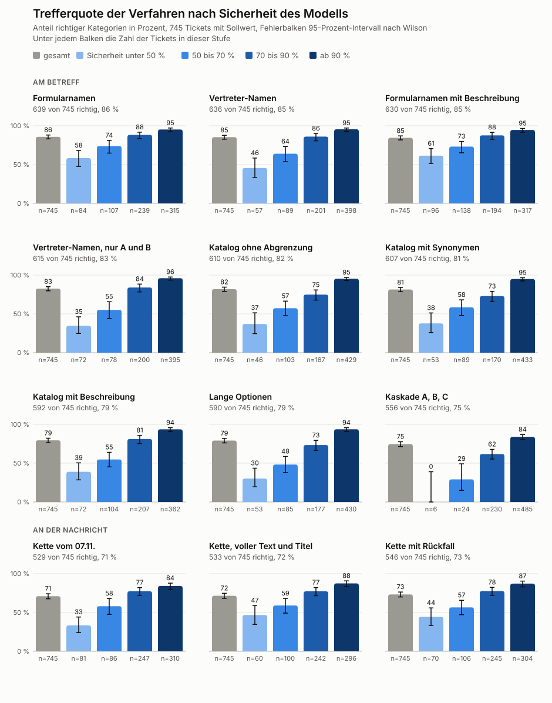

[[einordnung]]
== Einordnung von Anfragen

// Quelle docs/einordnung.md, Schritt 1 bis 16. Jede Weichenstellung verweist auf ihr ADR.

=== Erste Versuche mit erfundenen Tickets

// Schritt 1 bis 4, <<adr-0003>>

=== Echte Betreffe

// Schritt 5 bis 7, <<adr-0004>>, <<adr-0005>>

=== Echte Nachrichten

// Schritt 8, 9 und 15, <<adr-0006>>

=== Sollwerte und Vergleich mit 2022

// Schritt 10 und 11

=== Kategorien und Katalog in der Einordnung

// Schritt 12 bis 14, <<adr-0007>>, <<adr-0008>>, <<adr-0010>>

.Trefferquote der Verfahren nach Sicherheit des Modells

=== Rückfrage statt Fehler

// Schritt 16, <<adr-0011>>
