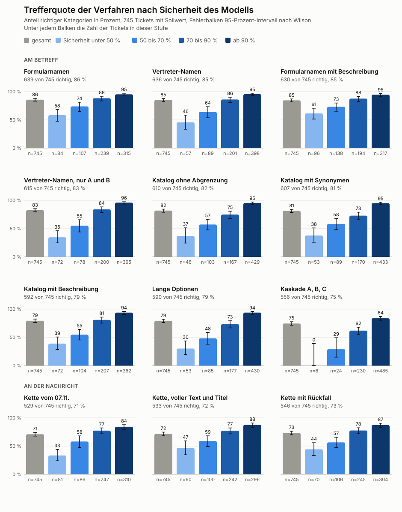

[[einordnung]]
== Einordnung von Anfragen

// Kern der Arbeit. Quelle docs/einordnung.md, Schritt 1 bis 16, iterativ erzählt.

=== Daten und Sollwerte

// 746 echte Tickets von 2024 bis 2026, Kontrolle durch das Team, zweite Prüfung, 279 Laufzettel von 2019 bis 2021.
// Warum eine Rückfrage als Erfolg zählt und schwere Fehler getrennt gemessen werden.

=== Erste Versuche mit erfundenen Tickets

// Schritt 1 bis 4, Sicherheit, Wunschzeit, Absicht, Übersetzung.

=== Vom Betreff zur Kategorie

// Schritt 5 bis 7 und 10, zwei Stufen gegen eine Stufe mit Vorauswahl, Sprachmodell als zweite Instanz.
// <<adr-0004>>, <<adr-0005>>

=== Nachrichten beim Eingang

// Schritt 8, 9 und 15, die Kette, mehrere Geräte in einer Anfrage, Voicemails. <<adr-0006>>

=== Kategorien und Zusammenfassungen

// Schritt 11 bis 13, aktuelle Liste, gleichwertige Einträge, ORA-Gruppe zuerst. <<adr-0007>>, <<adr-0008>>

=== Der Katalog in der Einordnung

// Schritt 14, Beschreibungen, lange Optionen, Kaskade, Vertreter-Namen. <<adr-0010>>

.Trefferquote der Verfahren nach Sicherheit des Modells

=== Rückfrage statt Fehler

// Schritt 16, Ursachen der sicheren Fehler, Regeln R1 und R2, Auflösung über die Nachricht. <<adr-0011>>

=== Wirkung der Aufbereitung

// Vergleich roh gegen aufbereitet wie Tabelle 2 der Datenpotenzialanalyse.
