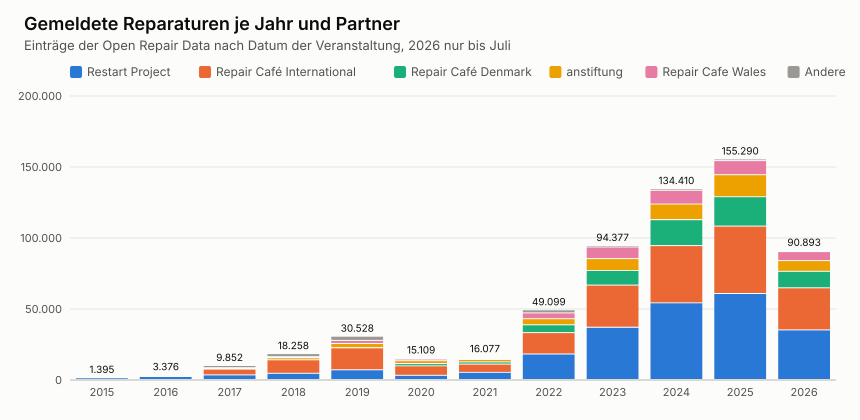
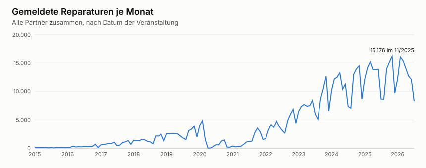
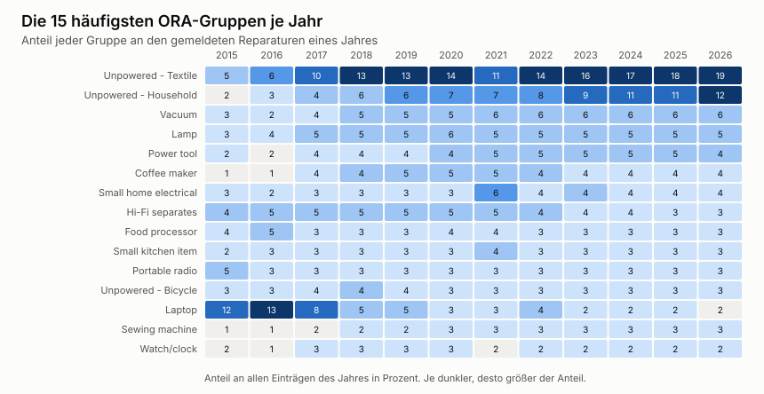

[[weitergabe]]
== Weitergabe der Daten und Termine

Reparaturdaten sind mehr als eine Statistik für den eigenen Verein. Zusammengeführt zeigen sie, welche Geräte kaputtgehen, woran Reparaturen scheitern und wo Hersteller nachbessern müssten. Dieses Kapitel beschreibt, wie die Daten des Repair Café zur Open Repair Alliance gelangen. Von dort stammen auch die Gruppen, nach denen der Katalog in <<katalog>> geordnet ist.

[[ora]]
=== Open Repair Alliance

Die Open Repair Alliance wurde von der anstiftung, Fixit Clinic, iFixit, der Repair Café Foundation und The Restart Project gegründet. The Restart Project koordiniert sie seit November 2017 <<ora-standard>>. Die Alliance führt die Daten ihrer Partner zweimal im Jahr zu einem gemeinsamen Datensatz zusammen und veröffentlicht ihn unter CC BY-SA 4.0 <<ora-datasets>>. Ausgewertet ist hier die Version 0.3 vom Juli 2026 <<ora-data>>.

==== Der Open Repair Data Standard

Der Standard legt fest, welche Felder ein Eintrag hat und welche Werte erlaubt sind <<ora-standard>>.

[cols="2,3,4",options="header"]
|===
|Feld |Name |Inhalt
|ID |`id` |Kennung beim Partner
|Kategorie des Partners |`partner_product_category` |eigene Liste oder Freitext
|Produktkategorie |`product_category` |eine von 40 Gruppen mit Strom, dazu Gruppen ohne Strom
|Marke |`brand` |Freitext
|Baujahr und Alter |`year_of_manufacture`, `product_age` |Jahr bzw. Alter in Jahren
|Problem |`problem` |Freitext ohne persönliche Daten
|Ergebnis |`repair_status` |Fixed, Repairable, End of life oder Unknown
|Hindernis |`repair_barrier_if_end_of_life` |sechs Gründe, nur bei End of life
|Gruppe und Datum |`group_identifier`, `event_date` |wer wann repariert hat
|===

Entscheidend für diese Arbeit ist das Verhältnis der ersten beiden Kategoriefelder. Jeder Partner erfasst mit seiner eigenen Liste. Die Alliance ordnet jede dieser Kategorien einer Produktkategorie des Standards zu und prüft die Zuordnung bei jedem neuen Datensatz <<ora-datasets>>. Die Produktkategorien des Standards heißen in dieser Arbeit ORA-Gruppen.

==== Die Partner

Der Datensatz enthält 620.000 Einträge von neun Partnern.

.Partner der Open Repair Alliance im Datensatz vom Juli 2026
[%header,format=tsv,cols="3,2,2,2,1,1,1,1,1,1,1"]
|===
include::../../docs/ora/partner.tsv[]
|===

Die Spalte `feste_stufe` zeigt, welcher Teil der Kategorie eines Partners aus einer festen Liste stammt. Eine 1 heißt, die erste Stufe ist fest und die zweite Freitext. Eine 2 heißt, beide Stufen sind fest. Eine 0 heißt, es gibt nur Freitext.

==== Der Datensatz im Überblick

Die Zahl der gemeldeten Reparaturen ist stark gewachsen, von 1.395 im Jahr 2015 auf 155.290 im Jahr 2025. Der Sprung ab 2022 kommt von allen großen Partnern gleichzeitig. 2020 bricht die Kurve wegen der Pandemie fast auf null ein. Jeden Sommer und um den Jahreswechsel gibt es Täler, weil dann weniger Veranstaltungen stattfinden. The Restart Project und Repair Café International liefern zusammen 70 Prozent aller Einträge.

.Gemeldete Reparaturen je Jahr und Partner

.Gemeldete Reparaturen je Monat

Auch die Mischung der Geräte hat sich verschoben. Textilien und Gegenstände ohne Strom aus dem Haushalt machen 2026 zusammen fast ein Drittel aus, 2015 waren es 7 Prozent. Laptops fielen von 12 auf 2 Prozent. Das liegt vermutlich weniger an den Geräten als an den Partnern. Anfangs meldete fast nur The Restart Project, dessen Veranstaltungen sich auf Elektronik konzentrieren.

.Die 15 häufigsten ORA-Gruppen je Jahr

Hinter den Einträgen stehen Gruppen und ihre Termine. Bei der anstiftung melden 169 Initiativen an 4.478 Terminen im Median 10 Geräte je Termin. Toronto und Fixit Clinic melden jeweils als eine einzige Gruppe.

.Gruppen, Termine und Einträge je Partner
[%header,format=tsv,cols="3,1,1,1,1,1,1"]
|===
include::../../docs/ora/events_by_partner.tsv[]
|===

==== Wie viel ankommt

Der Datensatz zeigt nur, was gemeldet wird. Beim Repair Café Gütersloh ist das ein kleiner Teil. Die eigene Statistik des Teams zählt seit 2019 1.485 bearbeitete Geräte an 85 Terminen. Auf reparatur-initiativen.org stehen für dieselbe Zeit 30 Laufzettel, das sind rund 2 Prozent. Alle 30 finden sich in den Open Repair Data wieder, unter der Gruppe 17503 mit denselben Terminen und Kategorien. Der Weg über die anstiftung funktioniert also. Es wird nur fast nichts gemeldet, weil jeder Laufzettel von Hand abgetippt werden muss.

.Bearbeitete Geräte und gemeldete Laufzettel des Repair Café Gütersloh
[cols="1,1,1,1",options="header"]
|===
|Jahr |Termine |bearbeitet |Laufzettel
|2019 |11 |147 |0
|2020 |6 |86 |22
|2021 |4 |45 |7
|2022 |2 |39 |0
|2023 |14 |227 |0
|2024 |14 |288 |0
|2025 |16 |316 |1
|2026 |18 |337 |0
|Summe |85 |1.485 |30
|===

Bei anderen Initiativen dürfte es ähnlich sein. Für die Auswertungen der Alliance heißt das, dass die Zahlen die Vielfalt der Geräte zeigen, aber nicht den Umfang der Reparaturen. Für MANUEL ist es der wichtigste Grund, die Übertragung zu automatisieren.

[[werkzeuge]]
=== Werkzeuge der Partner

Die Alliance empfiehlt, Reparaturen mit dem Werkzeug eines Partners zu erfassen, und bittet, nur ein Werkzeug zu nutzen, weil sonst doppelt gezählt wird <<ora-record>>.

[cols="2,2,3,2",options="header"]
|===
|Werkzeug |Partner |Kategorien |Schnittstelle
|Restarters.net mit Fixometer |The Restart Project, auch iFixit |47 feste Kategorien, dazu der Gegenstand als Freitext |API mit Lesen und Schreiben
|Repair Monitor |Repair Café International |16 Hauptkategorien mit festen Unterkategorien |keine öffentliche gefunden
|Laufzettel auf reparatur-initiativen.org |anstiftung |13 Ober- und rund 1.190 Unterkategorien, Initiativen können neue vorschlagen |API nur zum Lesen von Statistiken
|Online-Formulare |Repair Cafe Wales, Fixit Clinic |grobe Liste bzw. Freitext |keine
|Tabellen |Repair Café Denmark, Repair Café Toronto |Freitext |keine
|Repair Connects |Repair Together |direkt die ORA-Gruppen |keine gefunden
|===

Nur Restarters.net erlaubt es, Reparaturen über eine Schnittstelle anzulegen. Die API der anstiftung liefert Initiativen und Statistiken und braucht ein Token, ein Endpunkt für Laufzettel fehlt. Das gab den Ausschlag für <<adr-0014>>.

[[kategorien-vergleich]]
=== Kategorien im Vergleich

Die Matrix in <<anhang-kategorien>> stellt für jede ORA-Gruppe nebeneinander, mit welchen eigenen Kategorien die Partner deren Einträge erfasst haben. Die vollständige Zuordnung jeder Kategorie zu ihren ORA-Gruppen liegt in {repo}/docs/ora/kategorien-zuordnung.tsv[kategorien-zuordnung.tsv]. Drei Beobachtungen sind für MANUEL wichtig.

* *Feine Listen lassen sich eindeutig zuordnen.* Fast jede Kategorie der anstiftung landet bei genau einer ORA-Gruppe, nur 14 Zeilen der Zuordnung sind mehrdeutig. Unser Katalog baut auf dieser Liste auf und übernimmt damit diese Eindeutigkeit.
* *Grobe Listen brauchen den Freitext.* Restarters erfasst etwa Ladegeräte zu 70 Prozent unter Misc. Erst der Freitext im Feld für den Gegenstand erlaubt der Alliance die Zuordnung zu Battery/charger/adapter. Beim Repair Monitor verteilt sich fast jede dritte Unterkategorie auf mehrere Gruppen.
* *Freitext allein ist schwer auszuwerten.* Bei Toronto und Fixit Clinic decken selbst die 60 häufigsten Werte nur 57 bzw. 29 Prozent der Einträge ab, Schreibfehler und Mehrzahl inklusive.

Für die Übertragung an Restarters folgt daraus, dass MANUEL beide Felder sorgfältig füllt. Die Kategorie ergibt sich aus der ORA-Gruppe im Katalog, der Gegenstand aus dem englischen Namen des Eintrags.

[[restarters]]
=== Übertragung an Restarters.net

// API POST /api/v2/devices, Konto für MANUEL als Host der Gruppe, Token, Zuordnung der Kategorien, Größen bei Laptop und Fernseher. <<adr-0014>>

[[anstiftung]]
=== Termine bei der anstiftung

// Termine zum Abonnieren und Neuigkeiten bleiben auf reparatur-initiativen.org, keine Laufzettel mehr, Vorschlag einer schreibenden API.

[[terminvergabe]]
=== Terminvergabe

// Kapazität aus den Anmeldungen der Helfenden, Reihenfolge der Regeln. <<adr-0026>>
